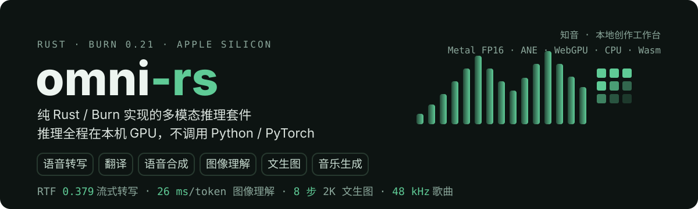
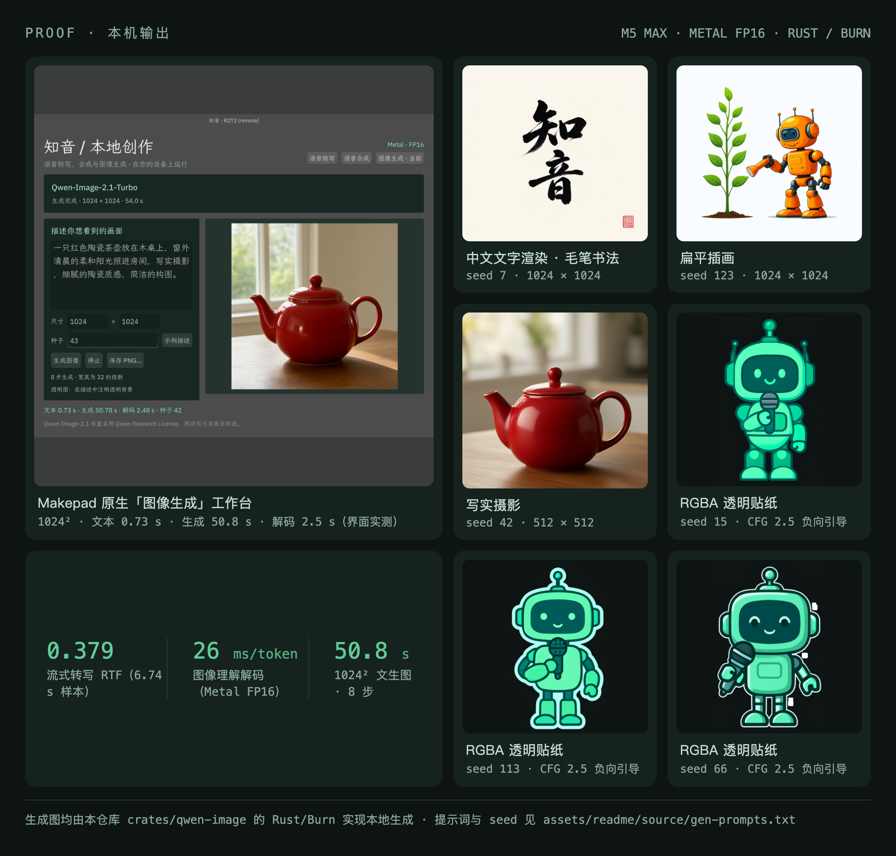
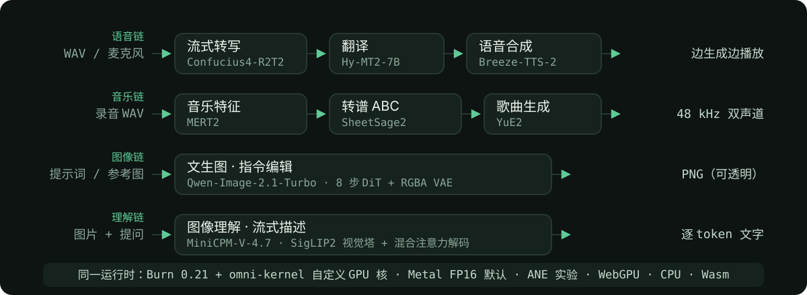

# omni-rs

<p align="center">
  
</p>

在一台 Mac 的 GPU 上跑完语音转写、翻译、语音合成、图像理解、文生图和音乐生成。核心 crate 是 `omni-r2t2`，推理用纯 Rust / [Burn 0.21.0](https://github.com/tracel-ai/burn/tree/v0.21.0)，不调用 Python、PyTorch、llama.cpp 或远程服务。默认后端是 Apple Silicon 的 Metal；实验性 ANE、WGPU/WGSL 和浏览器 WebGPU 是同一套模型的其它入口。

每个模块都用官方完整权重在本机 M5 Max 上跑通，并与官方 PyTorch / transformers 做了数值对照。条件、性能和范围见 [VALIDATION.md](VALIDATION.md)。

## 能力总览

| 能力 | 模型 | 入口 | 本机实测（M5 Max） |
| --- | --- | --- | --- |
| 流式语音识别 | [Confucius4-R2T2](https://modelscope.cn/models/netease-youdao/Confucius4-R2T2) | CLI · Makepad · Web | RTF 0.379，每步 p95 82.4 ms |
| 翻译 | [Hy-MT2-7B](https://huggingface.co/tencent/Hy-MT2-7B) | CLI · Makepad · API | RadixAttention 前缀缓存 + 连续批处理 |
| 语音合成 | Breeze-TTS-2 | Makepad | 流式边生成边播放，音色设计与声音克隆 |
| 图像理解 | [MiniCPM-V-4.7-1B](https://huggingface.co/openbmb/MiniCPM-V-4.7-1B) | CLI · Makepad | ≈26 ms/token（Metal FP16，贪心对齐官方） |
| 文生图 · 图像编辑 | Qwen-Image-2.1-Turbo | CLI · Makepad | 8 步生成，1024² ≈51 s，默认 2K |
| 音乐理解 · 歌曲生成 | MERT2 → SheetSage2 → YuE2 | Makepad · Web | 48 kHz 双声道 WAV |

## 本机实测

<p align="center">
  
</p>

左侧是 Makepad「图像生成」工作台（单图 1024²：文本 0.73 s + 生成 50.8 s + 解码 2.5 s）。右侧六张图都由 `crates/qwen-image` 在本机生成。三张透明贴纸用 CFG 2.5 负向引导清空背景。提示词、seed 与记录见 [assets/readme/source/gen-prompts.txt](assets/readme/source/gen-prompts.txt)。

## 快速开始

需要 Rust 1.92+。Cargo 不在 PATH 时先加载 `~/.cargo/env`。

```sh
git clone https://github.com/GoooIce/omni-rs && cd omni-rs
python3 scripts/download_model.py         # Confucius4-R2T2，约 4.08 GB，默认 ModelScope
cargo run --release -- doctor
cargo run --release -- transcribe \
  --model models/Confucius4-R2T2 --audio speech.wav \
  --language Chinese --chunk-ms 160 --lookahead-ms 160 --warmup --realtime
```

同一套界面里还有翻译、合成、文生图和音乐：

```sh
cargo run --release --manifest-path crates/omni-api/Cargo.toml -- --port 8848
# 打开 http://127.0.0.1:8848
python3 prototypes/makepad/build-native.py && ./target/release/r2t2-makepad
```

## 流水线

<p align="center">
  
</p>

## 模块

### 流式语音识别 · Confucius4-R2T2

WAV、16 kHz PCM 管道、可选麦克风，或浏览器 module worker。`--realtime` 按音频时钟喂入；不加时则尽快跑完，用来测速。官方 6.74 秒样本 **RTF 0.379、每步 p95 82.4 ms**（纯 Metal FP16，不含加载与预热）。跟不上输入会报错，不静默丢音频。

```sh
cargo run --release -- transcribe \
  --model models/Confucius4-R2T2 --audio speech.wav --json --warmup
```

麦克风需要系统录音权限，Linux 还要 ALSA 开发库。`chunk_ms` 为 80–2000 且是 10 ms 的倍数。下载可加 `--source huggingface`；本地目录至少要有 `config.json`、`tokenizer.json`、`model.safetensors`。会话语义见 [Rust 接口](#rust-接口)。

### 翻译 · Hy-MT2-7B

Makepad 的 ASR、TTS 页面都能翻译，两处共用一份模型和前缀缓存。目标语言写完整名称，如 `English`。原始权重约 16.1 GB，Apache-2.0，固定到上游 `9b0eb4e8f001def3e5ff6469a0ac96fdb39ec223`。

```sh
python3 scripts/download_hy_mt.py
cargo run --release --manifest-path crates/hy-mt/Cargo.toml -- \
  --text '今天天气很好，我们一起去公园散步吧。' --target-language English --json
```

默认 Metal FP16，温度 0.7、top-k 20、top-p 0.6、重复惩罚 1.05；`--greedy` 用于对照。输出上限默认 512 token，触顶返回 `finish_reason: "length"`。前缀缓存按 token 前缀映射 KV 页，活动翻译锁住自己的前缀，只淘汰未锁定的叶子；`--no-cache` 关闭跨请求缓存。CPU 用 `--no-default-features --features native,cpu`。

### 语音合成 · Breeze-TTS-2

在 Makepad「语言」工作台载入模型。支持中文/英文、音色设计、参考声音克隆、边生成边播放和 WAV 保存。权重与本地输出是研究/非商业许可。范围见 [接入说明](docs/breeze-tts.md)。

```sh
python3 scripts/download_breeze.py
python3 prototypes/makepad/build-native.py && ./target/release/r2t2-makepad
```

### 图像理解 · MiniCPM-V-4.7

单图加文字提示，流式出字。贪心输出与官方 transformers ≥5.18 逐 token 对齐，Metal FP16 约 26 ms/token。参数与限制见 [模块文档](crates/minicpm-v/README.md)。

```sh
python3 scripts/download_minicpm_v.py
cargo run --release --manifest-path crates/minicpm-v/Cargo.toml -- generate \
  --model models/MiniCPM-V-4.7-1B --image photo.jpg --prompt '描述这张图' --greedy
```

### 文生图与图像编辑 · Qwen-Image-2.1-Turbo

视觉编码器、文本编码器、扩散主干和 RGBA VAE 都在 `crates/qwen-image` 里。支持 8 步文生图、1–4 张参考图编辑和透明 PNG。完整权重约 32.5 GB，Qwen Research License。默认 2048×2048、seed 42；七组官方比例的最长边是 2752，自定义宽高须在 256–2752 且总像素不超过 4,300,800。

```sh
python3 scripts/download_qwen_image.py
./target/release/qwen-image generate --prompt "清晨的山谷，写实摄影" \
  --aspect-ratio 16:9 --output valley.png
```

透明背景不要只写在提示词里。本机 73 个 seed 里，纯提示词大约 1/20 全透明；加上 `--negative-prompt "opaque white background, solid background" --true-cfg-scale 2.5` 后 3/3 全透明。负向引导会增加去噪计算，默认仍是 8 步、CFG=1。`--rewrite` 会先用本仓库的 MiniCPM-V 扩写提示词（默认 35B，约 100–190 秒）。显式的宽高或比例优先于改写结果。停止不会把未完成的潜变量当成品。数值与实现见 [接入说明](docs/qwen-image-21.md)、[提示词改写](docs/qwen-image-rewrite.md)。

### 音乐理解 · 转谱 · 歌曲生成

导入 WAV 后走 **MERT2 → SheetSage2 → YuE2**：特征、ABC/MIDI，再按风格和歌词生成 **48 kHz 双声道 WAV**。也可以不给乐谱，让 YuE2 先写谱再生成。四份权重约 10.55 GB。转谱最长 5 分钟，超长会标明截断。用法与许可见 [音乐模块](crates/omni-music/README.md)。

```sh
uv run --with huggingface-hub==0.36.2 python scripts/download_music.py
cargo run --release --manifest-path crates/omni-api/Cargo.toml -- --port 8848
```

## 本地 Web API

服务默认只听 `127.0.0.1:8848`，模型按需载入。同一模型的请求可以合批（翻译、ASR、TTS 默认各最多 4 个，图像 1–4），不同模型按 FIFO 等待。取消在当前 GPU 步结束后生效。成品要等编码完成并原子发布才进入终态，文件在 `artifacts/api-output/published`。HTTP 目前是 WAV 转写、无参考音频的 TTS 和文生图；麦克风、声音克隆和参考图编辑留在原生界面。

```sh
cargo run --release --manifest-path crates/omni-api/Cargo.toml -- --port 8848

curl -s http://127.0.0.1:8848/v1/translations \
  -H 'Content-Type: application/json' \
  -d '{"text":"你好，世界！","target_language":"English"}'
# HTTP 202 与任务 id；GET /v1/jobs/<id> 读取译文
```

| 请求 | 输入 |
| --- | --- |
| `POST /v1/translations` | JSON：`text`、`target_language`，可选 `options` |
| `POST /v1/audio/transcriptions` | WAV 字节；可选查询参数 `language`、`context` |
| `POST /v1/audio/speech` | JSON：`text`，可选 `instruction`、`seed`、`max_frames`、`guidance_scale` |
| `POST /v1/images/generations` | JSON：`prompt`，可选 `width`、`height`、`seed`、`negative_prompt`、`true_cfg_scale` |
| `POST /v1/music/analyses` | WAV 字节，返回 MERT2 特征 |
| `POST /v1/music/scores` | WAV 字节，可选 `melody_only`；返回事件、MIDI 与 ABC |
| `POST /v1/music/generations` | JSON：`style`、`lyrics`，可选 `abc`、`cot`、`seed` |
| `GET /v1/jobs/{id}` · `DELETE /v1/jobs/{id}` | 查询或取消；状态为 `queued/running/done/cancelled/error` |
| `GET /v1/files/{name}` | 下载已发布的 WAV、PNG、JSON、ABC 或 MIDI |
| `GET /v1/models` · `GET /health` | 模型列表与服务状态 |

等待通道长度为 4，满了返回 503。目录可用 `--asr-model`、`--tts-model`、`--translation-model`、`--image-model`、`--music-models` 指定。

## 运行后端

当前机器是 M5 Max（40 核 GPU、128 GB）。默认 `--backend metal`：CubeCL/MSL、GPU FP16 矩阵、FP32 归一化与残差。`--precision f32` 只用于对照。

| 后端 | 何时用 | 入口 |
| --- | --- | --- |
| Metal | 原生界面的默认路径 | `--backend metal` |
| ANE | 实验。长流未过验收 | `--features ane -- --backend ane` |
| WebGPU | 其它桌面 GPU，或浏览器 | `--features native,webgpu` / Wasm |
| CPU | 正确性对照，不承诺实时 | `--features native,cpu -- --backend cpu` |

ANE 把 Burn 子图编译成 Core ML，再由 Swift 桥执行。无 ANE 分配或编译失败会按原因回退。2026-10-11 的固定 96 条中文集热态一轮 RTF 0.7708，但 40 秒连续输入 RTF 0.9951，30 分钟复测约 1.017，**长流验收未通过**。原生界面因此仍用 Metal。选择与对照见 [优化目标](docs/ane-optimization-goal.md) 和 [后端说明](crates/burn-ane/README.md)。

```sh
# WGPU/WGSL
cargo run --release --no-default-features --features native,webgpu -- \
  --backend webgpu transcribe --model models/Confucius4-R2T2 --audio speech.wav

# 浏览器：Wasm release 与完整权重已在本机 Chromium 实测
rustup target add wasm32-unknown-unknown
cargo install wasm-bindgen-cli --version 0.2.129 --locked
cargo build --release --target wasm32-unknown-unknown --no-default-features --features wasm
wasm-bindgen target/wasm32-unknown-unknown/release/omni_r2t2.wasm --target web --out-dir pkg
python3 scripts/pack_web.py models/Confucius4-R2T2 models/web
python3 -m http.server 8765
# 打开 http://localhost:8765/web/demo.html
```

浏览器输入是指定采样率的单声道 `Float32Array`，每次 `push` 都要 await。加载接口见 [web/load-model.js](web/load-model.js)。WebGPU 默认 160 ms 配置在本机仍慢于实时；Makepad 的 960 ms 快速档在 20 秒采集上 RTF 约 0.75。Windows/Linux 硬件未实测。

## Rust 接口

```rust,ignore
use std::sync::Arc;
use omni_r2t2::{Model, Precision, StreamConfig, Transcription};
use burn::backend::wgpu::{Metal, WgpuDevice, graphics, init_setup};

let device = WgpuDevice::default();
init_setup::<graphics::Metal>(&device, Default::default());
let model = Arc::new(Model::<Metal>::from_directory(
    "models/Confucius4-R2T2", Precision::F16, &device,
)?);
let mut run = Transcription::new(model, StreamConfig::default(), 48000)?;
for event in run.push(&mono48k).await? {
    print!("{}", event.event.delta);
}
for event in run.finish().await? {
    print!("{}", event.event.delta);
}
```

一个模型可以给多个会话共享；PCM 和 KV 属于各自会话，会话内串行。`delta` 只含新提交的文本，拼起来等于最终 `text`。打断用 `Session::stop_handle()` 置位，等当前 `push` / `finish` 在 GPU 回读边界退出，再调用 `interrupt()`。正常结束走 `finish()`，用来刷新尾音。

当前默认是单路贪心解码。API 可以建多个会话。没有 VAD 自动分句、词级时间戳或 WebSocket。量化权重不在这条 ASR 路径上。

## 验证

```sh
./scripts/check quick   # 约束、验证器反例、全部子项目格式
./scripts/check cpu     # 再跑 CPU Clippy 与测试
./scripts/check metal   # Apple Silicon 上的 Metal 与注意力数值对照
./scripts/check native  # 本机权重下的 ASR、生命周期和 TTS 回归
./scripts/check status
```

检查范围与中断恢复见 [开发工作流](docs/agent-workflow.md)。FP32/FP16、长流和浏览器结果在 [VALIDATION.md](VALIDATION.md)；这些是回归，不是完整语料的 WER/CER。给语言模型的仓库地图是 [llms.txt](llms.txt)。

官方小模型对照需要 Python 3.12+ 与 `scripts/requirements-reference.txt`，推理本身不依赖它们：

```sh
python3 scripts/export_reference.py artifacts/reference
cargo run --release --no-default-features --features native,cpu \
  --example verify_reference -- artifacts/reference
```

## 许可

本仓库 Rust 代码使用 [Apache-2.0](LICENSE)。权重不在仓库里，各自遵循官方许可：Hy-MT2-7B 为 Apache-2.0，Breeze-TTS-2 权重及本地输出为研究/非商业许可，Qwen-Image-2.1 为 Qwen Research License。其余见模块文档与 [THIRD_PARTY_NOTICES.md](THIRD_PARTY_NOTICES.md)。

源码参考：[R2T2 流式实现](https://github.com/netease-youdao/Confucius4-R2T2/blob/master/r2t2/r2t2_asr.py)、[Qwen3-ASR 网络](https://github.com/QwenLM/Qwen3-ASR/blob/main/qwen_asr/core/transformers_backend/modeling_qwen3_asr.py)、[官方模型配置](https://huggingface.co/netease-youdao/Confucius4-R2T2/blob/main/config.json)。
