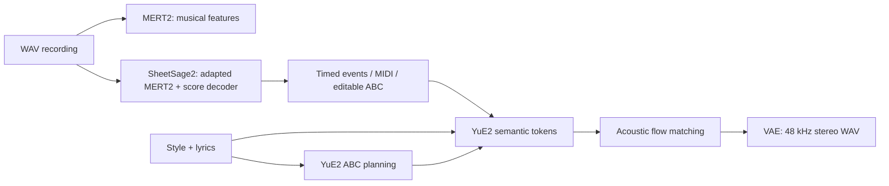

# Native music workflow

Rust/Burn inference for MERT2 representations, SheetSage2 transcription and YuE2
song generation. The production CLI and HTTP service do not invoke Python.
The Python programs in `scripts/` download checkpoints or run independent upstream
numerical references.

The supplied YuE repository now publishes YuE2. The implementation follows its
[recording-to-song workflow](https://github.com/multimodal-art-projection/YuE/blob/1647252d68b70cbead046ffd3f7caf036dde47ee/docs/covers.md).
Model identities and source evidence are in [the research record](../../docs/music-model-research.md).



Standalone MERT returns a pooled 1,024-dimensional representation, without a genre
or mood classifier. Transcription independently uses MERT with SheetSage2 adapters;
the standalone analysis output is not passed as an arbitrary YuE input. SheetSage2
transcribes audio; YuE2 composes from text and accepts the editable ABC handoff.
Raw MIDI import and PDF notation rendering are not implemented.

## Download and run

From the repository root:

```sh
uv run --with huggingface-hub==0.36.2 python scripts/download_music.py
cargo run --release --manifest-path crates/omni-api/Cargo.toml -- --port 8848
# Open http://127.0.0.1:8848 and use 音乐理解 → 乐谱 → 歌曲.
```

Alternatively install `huggingface-hub==0.36.2` in a Python environment and run the
same download script there. The four original checkpoints total about 10.55 GB.
Downloads pin revisions, check byte counts and LFS SHA256, and save per-file
manifests and original licenses in `models/`. Large downloads use the official
Hub transport, including its resumable LFS/Xet support.

The web workflow allows review/editing before generation and downloads features,
timed events, ABC, MIDI and audio. A failed ABC reconstruction preserves events
and MIDI and reports `abc_error`. Changing an input while a task runs does not
overwrite an edited score or automatically select an obsolete transcription.

The Makepad desktop exposes the same direct Rust pipeline under **音乐创作**.
Build with `python3 prototypes/makepad/build-native.py` and restart
`target/makepad-native/release/r2t2-makepad`. No API server is required.
It supports WAV import, analysis, editable ABC, transcription MIDI/events, score-
conditioned or text-only generation, stereo playback and output export.
Models load only when an operation needs them; shared native admission, progress
and cancellation also work across tabs. `MUSIC_MODELS_DIR` selects the parent
checkpoint directory. See [native usage and validation](../../prototypes/makepad/README.md#音乐创作).

```sh
cargo build --release --manifest-path crates/omni-music/Cargo.toml
crates/omni-music/target/release/music analyze recording.wav --output features.json
crates/omni-music/target/release/music transcribe recording.wav --output score
crates/omni-music/target/release/music generate request.json --output song
```

The default backend is Metal FP16; use `--precision f32` before the subcommand for
reference comparisons. `--models` changes the parent checkpoint directory.
Use `--no-default-features --features cpu` for NdArray, or `--features webgpu`
instead of CPU for native WebGPU. CPU builds/tests are covered; full-model
numerical validation uses Metal. This crate is not a browser/Wasm bundle.
Output directories for transcription/generation must be new. Ctrl-C cancels at
the next model boundary; the CLI retains already-written intermediate artifacts.

Example `request.json` (omit `abc` to compose a score from text):

```json
{
  "style": "Instrumental acoustic piano, gentle, warm, 120 BPM",
  "lyrics": "[Instrumental]",
  "cot": "full",
  "seed": 41,
  "semantic_sampling": { "max_tokens": 1500 },
  "ode_steps": 32
}
```

To reuse transcription, set `abc` to the contents of `score/score.abc` and
`cot` to `melody` for melody-only scores, or `full` for chord-annotated scores.
The CLI saves the exact plan and semantic token IDs, acoustic latents and WAV.
An unchanged generated plan retains its original ABC token IDs; editing ABC
creates a new prompt. Rust and PyTorch use different random generators: identical
seeds guarantee repeatability within a runtime, not cross-runtime stochastic
token or noise identity. Greedy decoding and externally supplied identical noise
support numerical comparison.

## API and execution boundaries

| Endpoint | Request | Completed result |
| --- | --- | --- |
| `POST /v1/music/analyses` | WAV bytes | MERT representation JSON |
| `POST /v1/music/scores?melody_only=true` | WAV bytes | Timed events, MIDI, ABC when valid |
| `POST /v1/music/generations` | SongRequest JSON | Stereo WAV, ABC, semantic tokens and request |

These return HTTP 202 with a job ID. Poll `/v1/jobs/{id}`, cancel with DELETE,
and download the returned `/v1/files/…` URLs. Music uses the existing FIFO queue,
one active music request at a time, with progress/cancellation through a bounded
channel. The model thread owns tensors; the Jobs layer alone publishes terminal
state and atomically publishes the complete result directory. Music cancellation
does not publish unfinished audio. Earlier completed downloads remain available.

MERT analysis accepts up to six minutes; transcription accepts up to five. Audio
is averaged to mono and resampled to 24 kHz. SheetSage2 always pads to its required
300-second context, including for short clips; long-recording overlap/stitching
is not implemented. The HTTP body limit is 64 MiB. ABC reconstruction uses measured
beats, meter, tempo and keys; it reports missing rhythm instead of inventing it.
Timed MIDI preserves raw event timing, while notation quantizes to the beat grid
and reports overlap clipping. Generated notation and transcriptions need musical
review.

YuE uses the checkpoint's 24,576-token context and reports `truncated` when a
planning or music token cap is reached. HTTP and CLI result metadata also distinguish
`score_truncated` and `music_truncated`. The 25 Hz semantic frame rate makes
1,500 tokens approximately 60 seconds; a length cap is not a promise of a complete
song. Acoustic synthesis preserves full attention context with bounded query
tiles, reuses invariant AR keys/values for each ODE step, and uses 32 midpoint
steps by default. The FP32 VAE decodes 256-frame tiles with a 16-frame halo and
exact cropping; natural audio length is `frames * 1920 - 64` samples per channel.

`paged_attention: true` opts into the shared private paged decoder cache for
YuE's autoregressive stages. It does not enable cross-request Radix reuse or music
continuous batching. MERT is bidirectional; its features and the acoustic/VAE
stages do not use a causal decode cache. The shared ASR/TTS/image scheduling
policies remain independent of the music task.

## Reference verification

See [VALIDATION.md](../../VALIDATION.md) and
[`reference-comparison.json`](../../artifacts/music-validation/reference-comparison.json).
The comparison script reads locally downloaded official model code using
`trust_remote_code=True`; it is a deliberate validation-only dependency.
Use separate environments: SheetSage2 requires Torch/Torchaudio 2.8.0 and
Transformers 4.45.2; YuE2 requires Torch 2.10.0 and Transformers 4.57.6.
See the downloaded upstream requirements for the remaining packages.

```sh
# Use the matching Python environment for each reference stage.
python scripts/validate_music_reference.py mert
python scripts/validate_music_reference.py sheet
python scripts/validate_music_reference.py yue
python scripts/validate_music_reference.py nar
python scripts/validate_music_reference.py vae
# After native outputs exist at artifacts/music-validation/:
python scripts/validate_music_reference.py compare

music --precision f32 acoustics artifacts/music-validation/song-burn-f32/semantic.json \
  artifacts/music-validation/noise-reference.f32 --output artifacts/music-validation/nar-burn.f32
cargo test --manifest-path crates/omni-music/Cargo.toml --no-default-features --features cpu
python scripts/validate_music_api.py --base http://127.0.0.1:8848 --output artifacts/music-api-new
```

The comparison fixture is an original synthetic piano phrase, not downloaded music.
The 64-token YuE numerical check intentionally produces a truncated short clip.
Runtime and checkpoint licensing are distinct; see [THIRD_PARTY.md](THIRD_PARTY.md).
