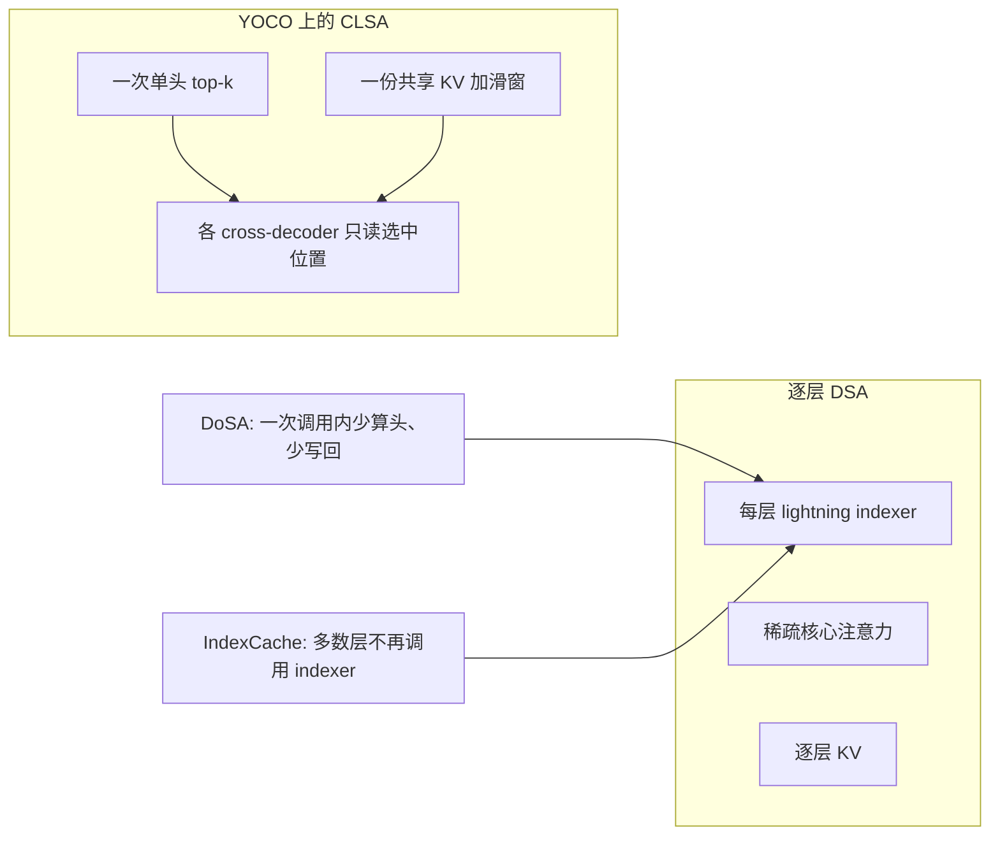

# DoSA、CLSA、IndexCache：三篇稀疏注意力论文对照

2026-10-21。材料只包括三篇 arXiv v1 的 HTML 全文，以及 export API 给出的题名、作者、时间和摘要。HTML 可以读完，没有改用 PDF，也没有采用博客、推文或二手综述。图里的曲线没有逐点读数；下面的数字都来自正文、表格或附录。能否接到本仓库，只在文末「接到当前推理」里说明。

书目接口：<https://export.arxiv.org/api/query?id_list=2610.13990,2606.06467,2603.12201>。三篇在接口里都只有 v1，`published` 与 `updated` 相同。

**结论：三篇减的都是「决定看哪些 token」的开销，但减的不是同一步。** DoSA 让一次 DSA indexer 少做多头打分和写回，Top-K 仍是原评分器的精确结果。IndexCache 让多数层不再调用 indexer，直接复用前面某层的下标，核心注意力和 KV 容量不动。CLSA 换的是整段 YOCO 架构：KV 只建一份，单头路由只算一次，再交给后面的 cross-decoder。三篇都没有做联合实验。从各自写明的机制看，只有「DSA 的 Full 层用 DoSA、Shared 层用 IndexCache」在接口上说得通，而且两份加速打在同一段 indexer 时间上，精确性也不再是每一层自己的 Top-K。CLSA 用的是单头索引器和共享 KV，与另外两篇的逐层多头 indexer 对不上。

## 1. DoSA（arXiv:2610.13990）

HTML：<https://arxiv.org/html/2610.13990>。摘要页：<https://arxiv.org/abs/2610.13990>。

### 1.1 身份与问题

| 项 | 论文所写 |
|---|---|
| 题名 | DoSA: Dots Sparse Attention |
| 作者 | Fanxu Meng，Taosong Fang。HTML 标为等贡献，作者顺序由掷硬币决定；单位 Dots Studio, Xiaohongshu Inc. |
| 日期 | 2026-09-26（v1） |
| 编号 | 2610.13990 |

问题句，来自摘要原文：Sparse attention visits few keys, yet finding them can still require scoring every key with every indexer head.

引言把这件事说成稀疏注意力内部仍有一次稠密扫描。DeepSeek Sparse Attention（DSA）用多头 indexer 加 Top-K 选 token；每个分数要做点积、ReLU 和带符号的加权求和。于是「选去哪看」本身会盖过稀疏注意力（[§1](https://arxiv.org/html/2610.13990)）。

### 1.2 机制：一次 indexer 调用里的可证伪剪枝

DoSA 改的是 indexer 的打分、写回和 Top-K，不改模型权重，不改 KV 布局，也不改稀疏核心注意力读哪些已选 token 的规则。论文自述：它是无损优化，用选中的头计算、用其余头的界来拒绝不可能进 Top-K 的 key；活下来的 key 仍用原来的全头分数（[§1](https://arxiv.org/html/2610.13990)、[§2.5](https://arxiv.org/html/2610.13990)）。

固定一个 query。H 个 indexer 头，分数是

\[
s_i=\sum_{h=1}^{H} w_h[\mathbf{q}_h^\top\mathbf{k}_i]_+
\]

只对可见 key 集合 \(\Omega\) 计算（[式 (1)，§2.1](https://arxiv.org/html/2610.13990)）。目标是在 \(|\Omega|\ge K\) 时找回分数最高的 K 个可见 key，同时不要对不可能入选的 key 做全头打分（[§2.1](https://arxiv.org/html/2610.13990)）。

证书分四步，论文的原话是：Top-K 需要的是足够拒绝一个候选的证据，不一定是它的完整分数。

1. 种子阈值。取至少 K 个可见 key 做原评分器的全部分数，令 \(\tau\) 为其中第 K 大。子集阈值不超过全集阈值；若上界 \(U_i<\tau\)，该 key 不可能进入 Top-K（[式 (2)，§2.2](https://arxiv.org/html/2610.13990)）。种子差只会让过滤变弱；多算出的精确分数只会抬高这个下界。
2. 保留头。保留 \(1\le r<H\) 个头，直接算它们的贡献。正权重头难以安全丢弃。若正权重头不多于 r，就全部保留，剩下的名额按负权重头的强度和种子激活不确定度来填；否则保留最强的 r 个正权重头。零权重头不贡献（[§2.2](https://arxiv.org/html/2610.13990)）。
3. 省略头的界。被省略的正权重头用非负投影套到某个已算的保留头上，残差用范数界住，残差之间还可以做一个联合界（[式 (4)–(7)，§2.3](https://arxiv.org/html/2610.13990)）。被省略的负权重头只会把分数往下拉；用种子上激活频率至少 1/2 的那些头做一个聚合方向，聚合后的 ReLU 不超过它们真正减去的量。其余负头直接忽略，这只会让上界更松、仍然安全（[式 (8)，§2.4](https://arxiv.org/html/2610.13990)）。频率只影响松紧，不影响正确性。
4. 上界与补分。合成后的 \(U_i\) 满足 \(s_i\le U_i\)（[式 (9)，§2.5](https://arxiv.org/html/2610.13990)）。\(U_i<\tau\) 的 key 丢掉并压缩幸存者编号；幸存者用全部 H 个原始头重算；只有 \(s_i\ge\tau\) 的分数写出，再和种子记录一起做最终 Top-K。等号两边都保留。界永不替代最终分数。

[定理 1，附录 A.2](https://arxiv.org/html/2610.13990) 写明：种子来自原评分器、被拒 key 满足 \(s_i\le U_i<\tau\)、没有丢失仍可能入选的候选，并且平局有共同全序时，结果与全量打分的 Top-K 相同。没有规定平局顺序时，返回的是式 (1) 下的一个合法 Top-K 集合。折叠进筛选计划的权重不属于模型参数（[§2.3](https://arxiv.org/html/2610.13990)）。

GPU 实现把这件事拆成规则的筛选遍和稀疏的全头补分（[§3](https://arxiv.org/html/2610.13990)、图 2、图 3）：

- 筛选与补分的矩阵乘用 Tensor Core；界和稀疏写回用 SIMT，累加器来自 TMEM。
- query 按相近的保留头预算分组，使筛选核可以做固定宽度的 Tensor Core MMA。保留行、折叠权重和两行 FP8 辅助向量准备一次，沿 key 分块复用。
- 四个 query 一组时，至少被两个界留下、且落在共同可见范围内的 key 走共享加载，用额外的一些 query–key 计算换更少的 key 传输。
- 写回只保留达到阈值的记录，存紧凑的单调分数码和精确 key id，再做精确选择。
- 解码 query 很少，跨 query 的 key 复用有限。解码路径保留完整 FP8 打分，用最近若干步选中的 key 当证人，压低选择工作，而不是把预填充那套分组筛选原样搬过去（[§3 Decoding](https://arxiv.org/html/2610.13990)）。

附录 C 把实数界和 FP8 实现分开：必须单独保证原评分器的计算分数不超过数值上界；只做 round-to-nearest 不够，要用向上取整或显式误差界。证书不能建立时，回到全可见域的原评分器和选择器，不能从残缺缓冲里重选。缓冲满了必须合并、扩容或全量恢复，丢掉溢出候选会丢 Top-K（[附录 C](https://arxiv.org/html/2610.13990)）。32 头实现里，r=14 和 r=16 用绝对值形式，r=20 仍用带正头投影的基本形式；两种形式都是 r+2 个逻辑点积（[附录 C.1](https://arxiv.org/html/2610.13990)）。

论文给出的实现入口是 <https://github.com/llm-sys/flash-indexer>（摘要下方链接）。

### 1.3 声称的收益

实验模型是 GLM-5.2 和 DeepSeek-V3.2，indexer 头数分别是 32 和 64，Top-K 都是 2048。微基准用 GLM-5.2、单卡。端到端是八路张量并行，GLM-5.2 的预填充块为 32K token，DeepSeek-V3.2 为 16K。基线是 SGLang v0.5.18 的全多头打分加 Top-K，以及 LiteTopK 的融合打分。硬件只写了 NVIDIA GPU，没有写具体型号。负载来自 InfiniteBench 的英、中、代码，以及 Project Gutenberg 和 SQLite 源码；上下文从 128K 到大约 1M。附录 D.1 规定这里的 1K 是 1024 token，大约 1M 是 1,048,569 token。完整 indexer 时延用 CUDA event，含 query/key 准备；端到端指标是单请求 TTFT，请求之间清空前缀缓存（[§4](https://arxiv.org/html/2610.13990)、[附录 D.1](https://arxiv.org/html/2610.13990)）。

| 场景 | 硬件 / 模型 | 基线 | 指标 | 论文数字 | 条件 |
|---|---|---|---|---|---|
| 大约 1M token 的预填充 | NVIDIA GPU，TP8；GLM-5.2 / DeepSeek-V3.2 | 关掉 DoSA 与 LiteTopK 的 SGLang | indexer 占预填充 GPU 时间 | 73.0% / 90.8% | 每个模型–长度两点请求取平均。逻辑矩阵 FLOP 占比是 47.4% / 83.2%。GLM-5.2 在 128K 时这一时间占比是 23.6%（[图 1，§1，§4.3](https://arxiv.org/html/2610.13990)） |
| 完整 indexer，60 组微基准 | 单卡，GLM-5.2，21 个产生 indexer 的层 | SGLang v0.5.18 | 时延加速 | 1.12×–2.74×；512K 及以上每一组都超过 2×；1M 时 2.47×–2.74× | 长度 128K/256K/512K/768K/1M，块 4K/8K/16K/32K，英/中/代码。60 组里 DoSA 都最快（[§4 Prefill](https://arxiv.org/html/2610.13990)） |
| 同上 | 同上 | LiteTopK | 时延加速 | 1.17×–1.69×；1M 时 1.47×–1.69× | 同上 |
| 上下文延长，块大小对照 | 英文，16K query | SGLang | 加速随长度 | 128K 为 1.19×，1M 为 2.58× | 1M 上把 query 块从 4K 增到 32K，加速只从 2.47× 变到 2.69×（[§4 Analysis](https://arxiv.org/html/2610.13990)） |
| 解码 indexer | 微基准段；约 1M KV | SGLang | indexer 加速 | 256K 为 1.06×，512K 为 1.11×，约 1M 为 1.26× | 来自压缩选择工作，不是预填充那套筛选。HTML 把图号指到了图 7，图 5 的标题才是 Decoding Indexer speedup（[§4 Decoding](https://arxiv.org/html/2610.13990)） |
| 证书剪枝率 | GLM-5.2，21 层 | 筛选前的 query–key 对 | \(1-N_{\mathrm{keep}}/N_{\mathrm{screen}}\) | 三个领域的层平均 97.2%–97.5%；20/21 层超过 95%；第 1 层最低，仍拒绝 89%–93% | （[§4 Pruning](https://arxiv.org/html/2610.13990)） |
| TTFT | TP8，GLM-5.2 | SGLang / LiteTopK | 单请求 TTFT | 约 1M 时 1.86× / 1.26× | 书和代码，128K 到约 1M（[§4.3](https://arxiv.org/html/2610.13990)） |
| TTFT | TP8，DeepSeek-V3.2 | SGLang / LiteTopK | 单请求 TTFT | 约 1M 时 1.94× / 1.50× | 同上。摘要里的 “up to 1.94× and 1.50× … over the two baselines” 与这两个最大值一致 |
| 消融 | 21 个 indexer 层；LOFT 的 SciFact；16K query、896K key | 既不筛选也不稀疏写回 | 检索时延 | 只筛选降 37.4%，只稀疏写回降 23.4%，两者一起降 47.3%（1.90×） | 筛选再加到只写回上，再省 31.1%；稀疏写回再加到只筛选上，再省 15.7%（[§4.4](https://arxiv.org/html/2610.13990)） |
| 去掉负头聚合 | GLM-5.2，最后 4K query，21 层 | 完整 DoSA | 候选存活率 / indexer 时间 | 存活率从 2.65% 升到 95.06%，indexer 时间变为 9.51× | 含候选池满之后的恢复。所有负头都聚合时，存活率 4.06%，时延高 12.0%。正头投影只在 0.42% 的 query–层行上需要（[附录 D.2](https://arxiv.org/html/2610.13990)） |
| 逐层检索 | GLM-5.2，最后 32K query，252 个输入×层格子 | SGLang / LiteTopK | 中位时延比 | 251/252 与 250/252 更快；对 SGLang 最高 3.74×，对 LiteTopK 最高 2.08× | 不计 query/key 准备。三格更慢，多 0.7%–9.0%。其中五格是候选缓冲修复后重测的；该修复在约 1M key 容量下多了 9.94 GiB 工作区（[附录 D.4](https://arxiv.org/html/2610.13990)） |

论文没有声称的部分，正文自己写了边界：

- 测量的是计算收益，不是训练上下文之外的任务准确率（[§6](https://arxiv.org/html/2610.13990)）。全文没有质量表格。
- 端到端只报告 TTFT，没有报告端到端解码吞吐。1.06×–1.26× 是解码 indexer，不是整段生成。
- 大约 1M 上「几乎把时延减半」指的是上述 TTFT 加速；注意力和 FFN 还在，所以 TTFT 加速小于 indexer 加速（[§4.3](https://arxiv.org/html/2610.13990)）。
- DeepSeek 上超出其声明上下文的测量，只支持计算规模观察，不支持任务准确率（[附录 D.1](https://arxiv.org/html/2610.13990)）。
- 合法的平局 Top-K 集合不必生成同一段文本（[§6](https://arxiv.org/html/2610.13990)）。
- 每个 key 仍然要扫描。短上下文或松的界可能省不下筛选本身的成本（[§6](https://arxiv.org/html/2610.13990)、[附录 B.3](https://arxiv.org/html/2610.13990)）。按块跳过 key 读取是未来工作，不是本文方法（[§6 Future work](https://arxiv.org/html/2610.13990)）。
- 60 组微基准全部更快，和附录里 252 个逐层格子并非全部更快，是两次不同的测量。

### 1.4 论文写明的前提

- 分数必须是式 (1) 那种带符号、逐头 ReLU 的 indexer。论文把证书称为针对有符号 DSA 分数定制的（[§6](https://arxiv.org/html/2610.13990)、[§5](https://arxiv.org/html/2610.13990)）。直接丢掉正权重头不安全（[§1](https://arxiv.org/html/2610.13990)）。
- 保留头数满足 \(1\le r<H\)，所以至少要有两个头，才存在「算一部分、界住其余」（[§2.2](https://arxiv.org/html/2610.13990)）。
- 实现路径使用 FP8 key、Tensor Core、SIMT 和 TMEM，计时用 CUDA event 和 Nsight。论文没有写其他厂商、其他编译器或其他核语言。也没有写必须是某一代 GPU；TMEM 是该实现使用的资源，证书本身在附录 A 里按实数证明。
- 不需要改权重，不需要草稿模型，也不是投机解码。实验的 K 是 2048，算法按一般的 K 陈述。
- 筛选要省逻辑点积，幸存比例必须低于 \(1-(r+d_a)/H\)。全部幸存时，筛选是纯增加的工作（[式 (20)–(21)，附录 B.3](https://arxiv.org/html/2610.13990)）。
- 相关工作里，IndexCache 这类跨层复用「不必保持原全分器的 Top-K」，被 DoSA 当成不同目标：DoSA 要在原评分器下证明拒绝有效（[§5](https://arxiv.org/html/2610.13990)）。

### 1.5 要和另外两篇叠在一起，论文机制要求什么

和 IndexCache 叠用时，Full 层的 indexer 仍得是式 (1)，并且 DoSA 最终写出的是 key id，而不是只有内部分数界。Shared 层要能只拷贝这些 id。DoSA 的精确性只相对于被调用的那一层评分器；它不能把另一层的下标证明成这一层的 Top-K。证书用的是本层的 \(w_h\) 和 \(\mathbf{q}_h\)，论文没有给出跨层共享筛选界的做法。

和 CLSA 叠用时，CLSA 的索引器得变成多头带符号 ReLU 分。CLSA 实际写的是单头点积（见第 2 节）。单头不满足 \(r<H\)。另外，DoSA 的收益来自每次调用里沿长 key 维少做全头算术；若整段模型只调用一次索引器，可减的调用内工作还在，但可减的「每层重算」不在 DoSA 这边。

两篇都没有讨论这种叠加。DoSA 只在相关工作里把 IndexCache 列为不保证原 Top-K 的方法（[§5](https://arxiv.org/html/2610.13990)）。

## 2. CLSA（arXiv:2606.06467）

HTML：<https://arxiv.org/html/2606.06467>。摘要页：<https://arxiv.org/abs/2606.06467>。

### 2.1 身份与问题

| 项 | 论文所写 |
|---|---|
| 题名 | You Only Index Once: Cross-Layer Sparse Attention with Shared Routing |
| 作者 | Yutao Sun，Yanqi Zhang，Li Dong，Jianyong Wang，Furu Wei。HTML 标等贡献，单位写 Microsoft Research 与 Tsinghua University |
| 日期 | 2026-06-04（v1） |
| 编号 | 2606.06467 |

问题句，来自摘要原文：Long-context inference in modern LLMs is increasingly constrained by decoding efficiency, especially in reasoning-heavy settings where models generate long intermediate chains of thought.

引言补充的矛盾是：块稀疏容易加速但掉质量；token 稀疏更准，但每一层都对全缓存做 top-k，端到端加速有限（[§1](https://arxiv.org/html/2606.06467)）。

### 2.2 机制：共享 KV 上再共享一次路由

CLSA 改的是模型结构，不是在现成 DSA 上换一个核。它建在 YOCO 这类交叉注意力架构上：self-decoder 保持 YOCO 原样，只建一份共享 KV；上面加一个轻量、单头、与 query 有关的 indexer；所有 cross-decoder 层复用这份 KV 和同一份 token 级 top-k 下标。每层仍有自己的 query 和 FFN（[§2](https://arxiv.org/html/2606.06467)、图 1）。

论文对索引器的描述是：在共享隐状态 \(H\) 上做单头投影

\[
Q_{\mathrm{idx}}=HW^Q_{\mathrm{idx}},\quad K_{\mathrm{idx}}=HW^K_{\mathrm{idx}},
\]

然后 \(I=Q_{\mathrm{idx}}K_{\mathrm{idx}}^\top\)，\(S_t=\mathrm{TopK}(I_t,k)\)，第 \(l\) 层只在 \(S_t\) 上做注意力。索引分支只有一个头，和主注意力的多头投影不同（[式 (2)–(4)，§2.1](https://arxiv.org/html/2606.06467)）。原文：Once multiple decoder layers attend to the same KV cache, they should also reuse the same routing index, so inference only needs to compute top-k once.

这和 DSA 的逐层 lightning indexer 不是同一个模块。表 1 把两者的复杂度分开写了（[表 1，§2.3](https://arxiv.org/html/2606.06467)）：

| 模型 | KV | 预填充 | 解码 |
|---|---|---|---|
| Transformer | \(\mathcal{O}(LND)\) | \(\mathcal{O}(LN^2D)\) | \(\mathcal{O}(LND)\) |
| DSA | \(\mathcal{O}(LND)\) | \(\mathcal{O}(LW_2ND+\eta LN^2)\) | \(\mathcal{O}(LW_2D+\eta LN)\) |
| YOCO 稠密 | \(\mathcal{O}((N+W_1L)D)\) | \(\mathcal{O}(\frac{L}{2}W_1ND)\) | \(\mathcal{O}(\frac{L}{2}(N+W_1)D)\) |
| YOCO（CLSA） | \(\mathcal{O}((N+W_1L)D)\) | \(\mathcal{O}(\frac{L}{2}W_1ND)\) | \(\mathcal{O}(\frac{L}{2}(W_1+W_2)D+\eta N)\) |

\(N\) 是序列长度，\(L\) 是层数，\(W_1\) 是局部窗口，\(W_2\) 是稀疏注意力选中的 token 数，\(\eta\) 是 indexer 每个 query–key 的路由成本。CLSA 的预填充复杂度和稠密 YOCO 相同；相对稠密 YOCO，变的是解码：跨层注意力从扫全缓存变成窗口加 \(W_2\)，indexer 从每层一次变成整段一次。KV 容量的下降来自 YOCO 的共享缓存，不是来自稀疏下标。

下标要同时服务多层，所以要训练。先把各层各头的 softmax 注意力平均成 \(\bar{A}\)，再用 KL 让 indexer 的 softmax 去拟合它，目标侧 stop-gradient（[式 (5)–(6)，§2.2](https://arxiv.org/html/2606.06467)）。阶段一只训 indexer，骨干冻结，损失就是这个 KD。阶段二是语言模型损失加 \(\lambda\mathcal{L}_{\mathrm{KD}}\)，全部实验 \(\lambda=0.1\)（[式 (7)–(8)，§2.2](https://arxiv.org/html/2606.06467)）。

实验模型是自己训的 4B，不是现成的 DSA 检查点。三套对照对齐宽度和深度：隐层 2560，FFN 7680，32 层，20 头，4 个 KV 头，头维 128，GQA，没有权重绑定。YOCO 把 32 层拆成 16 层 self-decoder 和 16 层 cross-decoder。self-decoder 的滑窗是 512。CLSA 最多激活 2048 个 token。Transformer 用 RoPE、base 500000；两个 YOCO 变体用 RNoPE：滑窗里 RoPE base 10000，全局注意力里 NoPE（[§3.1](https://arxiv.org/html/2606.06467)、[附录 C，表 7–8](https://arxiv.org/html/2606.06467)）。按表 1 的符号，这里 \(W_1=512\)、\(W_2=2048\)。

稠密预训练两阶段：每步 8M token；阶段一最大长度 8192，峰值学习率 \(3\times10^{-4}\)，125000 步；阶段二长度 32768，学习率 \(3\times10^{-5}\)，10000 步。稀疏适应也在 32768 长度上：两段各 2500 步，学习率先 \(3\times10^{-4}\) 再 \(3\times10^{-5}\)（[§3.1](https://arxiv.org/html/2606.06467)、[附录 B，表 5–6](https://arxiv.org/html/2606.06467)）。

### 2.3 声称的收益

效率测量接进 vLLM，在 NVIDIA B200 上做端到端服务。论文没有写批量、并发或用了几张 B200（[§3.4](https://arxiv.org/html/2606.06467)、[附录 E](https://arxiv.org/html/2606.06467)）。摘要和结论里的 \(7.6\times\) 解码、\(17.1\times\) 总吞吐，都是 128K、相对 Transformer。

解码吞吐，token/s（[表 11，附录 E](https://arxiv.org/html/2606.06467)）：

| 上下文 | Transformer | YOCO 稠密 | YOCO（CLSA） |
|---:|---:|---:|---:|
| 8K | 4762.79 | 5516.50 | 6742.39 |
| 16K | 3091.32 | 4147.85 | 6350.39 |
| 32K | 1761.72 | 2677.12 | 5461.33 |
| 64K | 948.15 | 1600.00 | 4137.37 |
| 128K | 431.16 | 960.94 | 3276.80 |

总吞吐，token/s（[表 12](https://arxiv.org/html/2606.06467)）：

| 上下文 | Transformer | YOCO 稠密 | YOCO（CLSA） |
|---:|---:|---:|---:|
| 8K | 2989.78 | 4311.58 | 4920.12 |
| 16K | 1449.91 | 2904.96 | 3715.19 |
| 32K | 570.27 | 1832.66 | 2805.48 |
| 64K | 191.36 | 1042.90 | 1735.59 |
| 128K | 62.53 | 599.05 | 1068.06 |

预填充吞吐，token/s（[表 10](https://arxiv.org/html/2606.06467)）：

| 上下文 | Transformer | YOCO 稠密 | YOCO（CLSA） |
|---:|---:|---:|---:|
| 8K | 4721.71 | 10884.35 | 9623.48 |
| 16K | 4160.92 | 13033.56 | 11572.40 |
| 32K | 2889.39 | 18450.18 | 18163.24 |
| 64K | 1741.56 | 20343.94 | 20349.11 |
| 128K | 1019.06 | 20864.85 | 20741.51 |

正文的解读是：两个 YOCO 变体的预填充都明显快于 Transformer，因为架构避开了全上下文的二次注意力；CLSA 的预填充接近稠密 YOCO。稀疏化的主要收益在解码，并且随上下文变大（[§3.4](https://arxiv.org/html/2606.06467)）。表 10 里 128K 的 CLSA 预填充是 20741.51，稠密 YOCO 是 20864.85；论文没有声称 CLSA 的预填充快过稠密 YOCO。

逐层时延在 128K、按 32 层归一化之后，单位 ms（[表 9，附录 D](https://arxiv.org/html/2606.06467)）：Transformer 的 MLP 0.17、稠密注意力 2.11、合计 2.28；稠密 YOCO 的注意力项 0.87、合计 1.04；CLSA 的稀疏注意力 0.05、top-k 0.08、合计 0.31。这个 0.08 ms 是一次性路由除以 32 层后的数；真正的共享发生在 16 个 cross-decoder 层。论文没有另给未摊销的毫秒数，只说不摊销时 top-k 可以和稠密注意力相当，甚至更大（[§3.4](https://arxiv.org/html/2606.06467)）。同一节用定性比较说：128K 上逐层独立 top-k 的 DSA 比稠密 Transformer 更慢；IndexCache 跨四层复用路由、HySparse 混合块稀疏和稠密层，都还留有明显的注意力或路由成本；CLSA 的逐层时延最低。这里没有印出相对 IndexCache 的倍数。

短上下文质量是表 2 的 4B 结果（[表 2，§3.2](https://arxiv.org/html/2606.06467)）：

| 模型 | ARC-C | BBH | GSM8K | HellaSwag | HumanEval | MMLU | DROP | WinoGrande |
|---|---:|---:|---:|---:|---:|---:|---:|---:|
| Transformer | 0.453 | 0.420 | 0.434 | 0.667 | 0.384 | 0.527 | 0.366 | 0.638 |
| YOCO 稠密 | 0.461 | 0.411 | 0.430 | 0.676 | 0.396 | 0.519 | 0.387 | 0.630 |
| YOCO（CLSA） | 0.465 | 0.418 | 0.470 | 0.674 | 0.396 | 0.513 | 0.391 | 0.616 |

论文说 CLSA 保持稠密模型的整体能力，并在 ARC-C、GSM8K、DROP 上最好，HumanEval 打平最好成绩；BBH、MMLU、HellaSwag、WinoGrande 接近稠密基线。表内 MMLU 从 Transformer 的 0.527 到 CLSA 的 0.513，WinoGrande 从 0.638 到 0.616。RULER 平均分：16K 上 Transformer 64.4、稠密 YOCO 62.7、CLSA 62.9；32K 上分别是 46.2、52.3、53.1，32K 的最好平均分是 CLSA（[表 3，§3.3](https://arxiv.org/html/2606.06467)）。Books、ArXiv、StarCoder 上 8K 到 32K 的验证损失曲线接近重叠，论文据此说长上下文建模上 CLSA 实际上无损（[图 2，§3.3](https://arxiv.org/html/2606.06467)）。

注意力覆盖（[表 4，§3.5](https://arxiv.org/html/2606.06467)）：2048 个 token、也就是 1:16 的激活比，盖住的稠密注意力质量在 StarCoder 为 84.12%，Books 为 76.29%，ArXiv 为 80.67%。相对稠密 YOCO 的交叉熵差，2048 时 StarCoder 为 −0.0004，Books 为 +0.0054，ArXiv 为 +0.0026。论文把差总结为大约 0.006 或更小。

论文没有声称的部分：

- \(7.6\times\) 和 \(17.1\times\) 不是相对稠密 YOCO，也不是 8K 上的解码倍数。8K 解码的原始吞吐是 6742.39 对 4762.79。
- 没有 30B、744B 或 DSA/GLM/DeepSeek 检查点上的结果。效率只在这套 4B、B200、vLLM 测量里。
- 没有写激活或权重精度，没有写核语言。
- 预填充加速相对 Transformer 时，表 1 把它记在 YOCO 的账上；CLSA 没有改这份预填充复杂度。
- 「几乎无损」是论文对表 2、表 3 和图 2 的概括，不是每一项都高于 Transformer。

### 2.4 论文写明的前提

- 必须是共享同一份 KV 的 cross-decoder。路由下标绑在这份内存上（[§2.1](https://arxiv.org/html/2606.06467)）。
- 索引器是单头，要经过多层蒸馏和随后的稀疏适应。只换推理图、不训练，不在本文实验里。
- self-decoder 仍是窗口 512 的滑窗注意力；位置编码是 RNoPE，不是全程 RoPE。
- 最大激活 token 数在实验里是 2048。论文没有说这个 k 可以随便套到别的模型上而不再训练。
- 服务栈是 vLLM，设备是 NVIDIA B200。没有草稿模型，没有投机解码。
- 块稀疏被当成质量上对不齐长上下文检索的归纳偏置；CLSA 保留 token 级下标，靠数据分布和共享 KV 带来的跨层分数相似性来共享，而不是靠块结构（[§3.5](https://arxiv.org/html/2606.06467)）。这是设计理由，不是一条形式化的互斥定理。
- 相关工作认为，在普通注意力架构里做跨层显著 token 复用，实际加速往往有限；本文把这件事放进 YOCO，要改善的是解码，预填充和 KV 仍靠 YOCO（[§4.1](https://arxiv.org/html/2606.06467)）。

### 2.5 要和另外两篇叠在一起，论文机制要求什么

CLSA 已经把 cross-decoder 的路由收成一次单头 top-k。IndexCache 要起作用，模型里还得留着多层 DSA indexer 可供跳过。两套共享若同时按原文实现，后一套没有剩余的逐层 indexer。CLSA 引用了 IndexCache，并在 128K 逐层时延里把它当作「跨四层复用」的对照，结论是完全摊到全部 cross-decoder 更低（[§3.4](https://arxiv.org/html/2606.06467)、[§4.1](https://arxiv.org/html/2606.06467)）。引用不等于联用实验。

DoSA 要套到 CLSA 的索引器上，这个索引器得改成式 (1) 的多头有符号分，并且 \(H>r\ge 1\)。CLSA 写明只有一个头。即便把 DoSA 只当成「更快的 top-k」，CLSA 在 128K 上把路由摊完之后，表 9 里剩下的大项是 MLP 0.17 ms，稀疏注意力 0.05 ms，摊销 top-k 0.08 ms。论文没有说再用证书去减这 0.08 ms。

## 3. IndexCache（arXiv:2603.12201）

HTML：<https://arxiv.org/html/2603.12201>。摘要页：<https://arxiv.org/abs/2603.12201>。

### 3.1 身份与问题

| 项 | 论文所写 |
|---|---|
| 题名 | IndexCache: Accelerating Sparse Attention via Cross-Layer Index Reuse |
| 作者 | Yushi Bai，Qian Dong，Ting Jiang，Xin Lv，Zhengxiao Du，Aohan Zeng，Jie Tang，Juanzi Li。HTML 中有 Z.ai 与 Tsinghua University，并有在 Z.ai 实习期间完成的脚注 |
| 日期 | 2026-03-12（v1） |
| 编号 | 2603.12201 |

问题句，来自摘要：DSA 的 lightning indexer 把核心注意力从 \(O(L^2)\) 降到 \(O(Lk)\)，但 indexer 自己仍是 \(O(L^2)\)，而且每一层都要独立跑，尽管相邻层的 top-k 高度相似。

\(L\) 在摘要里是序列长度。后文用 \(N\) 表示层数、\(L\) 表示序列长度、\(k\) 表示每 query 选中的 token 数，全文 \(k=2048\)（[§2.1](https://arxiv.org/html/2603.12201)、[记号段](https://arxiv.org/html/2603.12201)）。

### 3.2 机制：少调用 indexer，不改核心注意力

IndexCache 改的是「哪些层还运行 indexer」。层被分成 F（Full）和 S（Shared）。F 层照常跑本层 lightning indexer，得到 top-k，并写进一个临时下标缓冲。S 层没有 indexer，直接使用最近的前驱 F 层的下标，再做原来的稀疏核心注意力和 FFN。第一层永远是 F。推理循环里只多一个条件分支（[图 2，§3](https://arxiv.org/html/2603.12201)）。

原文对内存的说法是：\(\mathcal{T}_{\mathrm{cache}}\) 只保存当前这份下标，下一层 F 会覆盖它，除了标准 DSA 已经分配的之外，不需要额外 GPU 内存。核心注意力仍是 \(O(NLk)\)，被拿掉的是总 indexer 成本 \(O(NL^2)\) 里的大部分（[§3](https://arxiv.org/html/2603.12201)）。它不共享 KV。第 5.2 节把跨层 KV 共享（包括 YOCO）写成另一条线，并说那些方法要有全注意力层当 oracle，而 DSA 已经把全注意力换成了 indexer。

DSA 的 indexer 在本文里被描述为多头 ReLU 门控点积、头数少、低秩投影、FP8，单 FLOP 比主路径的 MLA 便宜一个数量级；然后 top-k，\(k=2048\ll L\)（[§2.1](https://arxiv.org/html/2603.12201)）。IndexCache 没有改这个分数公式。

免训练版本不更新权重。均匀交错（每 r 层留一个 indexer）会伤质量，因为各层 indexer 的重要性不同。作者改为贪心：从全 F 开始，每一步把「改成 S 后校准集语言模型损失最低」的层固定成 S，直到 S 层达到目标个数。校准集是同一批 SFT 数据，batch 768，上下文 200K。完整搜索要 \(N(N-1)/2\) 次前向；流水并行把模型切成 P 段时，前向次数大约降到原来的 \(1/P\)，每段的第一层固定为 F（[§3.1，算法 1](https://arxiv.org/html/2603.12201)）。贪心不保证全局最优。用注意力输出余弦相似度加动态规划来选 pattern 是负结果：下游和均匀交错一样掉点（[附录 C，表 5](https://arxiv.org/html/2603.12201)）。

训练版本把保留下来的 indexer 从「只拟合本层注意力」改成拟合它要服务的连续层。F 层 \(\ell\) 若还要服务后面 m 个 S 层，损失是这 m+1 层聚合注意力分布对 indexer 分布的 KL 平均（[式 (1)，§3.2](https://arxiv.org/html/2603.12201)）。命题 1 证明，这和拟合这些分布的平均有相同的参数梯度。实现用多项目 KL，避免把平均分布物化出来。训练仍是 DSA 的两阶段：热身只训 F 层 indexer，稀疏阶段继续用该损失（只在 top-k 上算 KL）并加上语言模型损失。

30B 实验模型从 GLM-4.7-Flash 的基座做出 DSA：30B-A3B MoE，MLA，47 层（[§4.1](https://arxiv.org/html/2603.12201)）。免训练搜索用的是已经训好的这份 DSA。训练版因为完整继续预训练太贵，改为从 GLM-4.7-Flash 直接在 200K 的 SFT 上训：稠密热身 1000 步，稀疏训练 4000 步。因此表 3 的 DSA 基线和表 2 不是同一次训练（[§4.1、§4.4](https://arxiv.org/html/2603.12201)）。

30B 上搜出的 1/4 保留 pattern 是 `FSFSFSSSSFSSSFSSFFSSFSSFSSSSFSSSFSSSSFSSSSSSSSS`；1/2 和 1/8 的串，以及 GLM-5 的两串，在附录 B。GLM-5 是 744B 参数、40B 激活，默认用 DSA（[§4.5](https://arxiv.org/html/2603.12201)）。

跨层重叠是动机，不是算法本身：47 层 30B 模型上，\(k=2048\)，768 条 200K 样本，相邻层 top-k 重叠 0.7–1.0；早层和晚层角落的重叠 \(\le 0.4\)。贪心分出的共享块和重叠聚类并不重合，因为重叠数不清「差的是哪些关键 token」（[附录 A](https://arxiv.org/html/2603.12201)）。

### 3.3 声称的收益

30B 的速度在 SGLang 里测，打开 `dp_attention`，`dp_size=8`，一台 NVIDIA H100 节点。吞吐按每张 GPU 报告。预填充时间就是文中的 TTFT。解码有两种：每张 GPU 上单请求并发，以及每张 GPU 的 KV 用满（约 800K token）时的总吞吐（[表 1，§4.2](https://arxiv.org/html/2603.12201)）。

| 指标 | 上下文 | DSA | IndexCache 1/2 | IndexCache 1/4 |
|---|---:|---:|---:|---:|
| 预填充时间（秒，越低越好） | 10K | 0.57 | 0.47 | 0.45 |
| | 60K | 3.38 | 2.86 | 2.59 |
| | 120K | 8.57 | 6.57 | 5.66 |
| | 200K | 19.5 | 13.7 | 10.7 |
| 单请求解码（tok/s，越高越好） | 10K | 73.5 | 84.5 | 91.0 |
| | 60K | 67.0 | 80.0 | 89.5 |
| | 120K | 63.0 | 77.0 | 88.0 |
| | 200K | 58.0 | 73.0 | 86.0 |
| KV 用满时的解码（tok/s / GPU） | 10K | 2700 | 3070 | 3310 |
| | 60K | 613 | 750 | 840 |
| | 120K | 341 | 431 | 498 |
| | 200K | 197 | 253 | 297 |

正文只把 1/4 折成倍数：200K 预填充 19.5 秒到 10.7 秒，1.82×；10K 预填充 1.27×；200K 单请求解码 58 到 86 tok/s，1.48×；KV 用满时 197 到 297 tok/s，1.51×，各长度上总解码吞吐提高 22%–51%。超过 200K 会更快是外推，不是测量（[§4.2](https://arxiv.org/html/2603.12201)）。摘要里的 1.82× 预填充和 1.48× 解码指的就是这组 30B、1/4、200K、相对标准 DSA 的数。

GLM-5 的速度没有单独的表。图 1 的说明是：去掉 50% indexer 计算，长上下文和推理任务上表现相当，端到端大约 1.2×。第 4.2 节另写：1/4 保留时，上下文超过 100K，预填充时延和解码吞吐至少 1.3×。第 1 节的「至少 1.3×」没有再拆预填充和解码。这三句不要并成一个数字。表 4 只有质量，没有速度。

免训练质量，长上下文平均与通用及推理平均（[表 2，§4.3](https://arxiv.org/html/2603.12201)）。原 DSA 的 Long 是 50.2，G&R 是 74.6。

| 配置 | Long | G&R |
|---|---:|---:|
| 原 DSA | 50.2 | 74.6 |
| 1/2 均匀 | 47.4 | 74.3 |
| 1/2 搜索 | 50.3 | 74.4 |
| 1/4 均匀 | 43.0 | 73.8 |
| 1/4 搜索 | 49.9 | 74.9 |
| 1/8 均匀 | 35.3 | 70.0 |
| 1/8 搜索 | 46.1 | 73.7 |

论文把 1/2 和 1/4 的搜索结果称为与原 DSA 相当，并把均匀交错的下降当成「留哪些层比留多少层更重要」。1/8 即使搜索，Long 仍到 46.1，长上下文下降被写成不可忽略。除 1/8 均匀以外，G&R 平均落在 73.7–74.9，相对 74.6 不超过 1 分。1/4 搜索的 AIME 2025 是 92.6 对 91.0，GPQA-Diamond 是 78.6 对 77.6。

训练版的基线已经不同：Long 51.0，G&R 74.2（[表 3，§4.4](https://arxiv.org/html/2603.12201)）。均匀 1/2 为 51.6 / 74.5，均匀 1/4 为 50.6 / 74.1。1/2 上换成搜索 pattern 是 50.6 / 73.6，去掉跨层蒸馏损失是 49.8 / 74.5，其中 AA-LCR 从 49.8 降到 44.0。论文据此说，重新训练之后，均匀 pattern 就能对齐全 indexer，层敏感性消失；跨层蒸馏有实际收益。1/4 的两项平均都在该节基线的 0.4% 以内。这个 0.4% 是论文的说法，基线是缩短流程训出的 DSA，不是表 2 的 50.2。

GLM-5 免训练的 Long 平均（[表 4，§4.5](https://arxiv.org/html/2603.12201)）：原 DSA 78.4；1/2 均匀 78.1，1/2 搜索 78.7；1/4 均匀 72.7，1/4 搜索 78.0。图 1 的全量评价对应 1/2 保留，论文说与原 GLM-5 几乎相同。训练版 IndexCache 还没有用到 GLM-5 上，这是作者写明的后续计划。

评测设置：温度 1.0，top-p 0.95，top-k 40。长上下文窗口 200K，其中 32K 留给输出；通用和推理任务最大输出 64K（[附录 D](https://arxiv.org/html/2603.12201)）。

论文没有声称的部分：

- 没有减少 KV，也没有把核心注意力再降到 DSA 已有的 \(O(Lk)\) 以下。
- 1.82× / 1.48× 不是 GLM-5 的数，也不是 1/2 保留或 10K 预填充的数。
- 结论里「去掉至多 75% indexer、且没有性能下降」对应的是 1/4 这一档在表 2 搜索结果和表 3 上被作者视为可忽略的下降，不是 1/8，也不是均匀 1/4（Long 43.0）。
- 下标复用不是精确 Top-K。附录 A 的重叠最高到 1.0，但早层对晚层可以 \(\le 0.4\)。
- 相似度搜索不能代替损失搜索。
- 没有草稿模型，没有新的编译器或核语言，没有写 DoSA 那种证书。

### 3.4 论文写明的前提

- 对象是带逐层 lightning indexer 的 DSA。第一层必须是 F。S 层只能向更早的 F 层要下标。
- 实验固定 \(k=2048\)。30B 是 MLA MoE；速度在 H100 节点、SGLang、`dp_size=8` 上测量。
- 免训练必须做校准前向，pattern 随模型变，附录 B 的 30B 串不能当成 GLM-5 的串。
- 均匀交错在免训练、尤其是 1/4 和 1/8 时，论文认为会掉长上下文质量。
- 训练版要改 indexer 的蒸馏目标，并让 S 层适应继承来的下标。热身加稀疏阶段在本文的缩短流程里是 1000+4000 步。
- FP8、少头、低秩是在描述 DSA indexer，不是 IndexCache 新加的量化。
- 第 5.2 节说原则可以推广到任何动态选 token 的稀疏注意力，例如 MoBA 和 NSA 的块选择。这是展望，本文实验只做了 DSA。

### 3.5 要和另外两篇叠在一起，论文机制要求什么

和 DoSA 叠用时，F 层 indexer 必须仍是 DoSA 能证明的那种分数，并且 F 层输出的是 S 层可拷贝的 top-k 下标。S 层不再调用 indexer，因此 S 层上没有 DoSA 可加速的打分。两篇都没有写共享筛选界或共享 FP8 证书。IndexCache 论文没有引用 DoSA；DoSA 晚于它，并明确把跨层复用排除在「原评分器精确 Top-K」之外。

和 CLSA 叠用时，模型得同时具备「多层 DSA indexer」和「YOCO 的一份 KV、一次单头路由」。IndexCache 的循环依赖前者，CLSA 的式 (2)–(4) 实现的是后者。IndexCache 写了自己不加 GPU 内存、也不共享 KV；CLSA 的内存收益恰恰来自共享 KV。蒸馏目标也不相同：IndexCache 每个 F 层拟合自己服务的那一段层，CLSA 的一个 indexer 拟合所有 decoder 层的平均。论文没有定义一个同时满足两边的训练目标。

## Stacking

三篇之间的引用只有单方向，而且没有联用数据。IndexCache（2026-03-12）没有引用后两篇；它把 YOCO 当作 KV 共享的前作，不是当作 CLSA。CLSA（2026-06-04）引用 IndexCache，把它当作跨层复用路由的相关工作和时延对照。DoSA（2026-09-26）引用 IndexCache，把它放进「不必保持原评分器 Top-K」的一类。没有任何一篇写下 DoSA+IndexCache、DoSA+CLSA 或三者同时开启的实验、消融或复杂度。

### 各自打的瓶颈

| 论文 | 实际打到的瓶颈 | 不动的部分 |
|---|---|---|
| DoSA | 单次 indexer 调用里的多头打分、分数写回和 Top-K。预填充上，长 key 维越长，收益越大。解码只减选择工作，打分仍是完整 FP8 | 调用次数、选中集合的定义、KV 容量、核心注意力的算子、FFN。key 仍逐个扫描 |
| IndexCache | indexer 的调用次数。1/4 保留就是去掉 75% 的 indexer 前向。预填充和解码都会碰到这层成本，因为 DSA 解码仍要对全上下文做逐 token 的 indexer | 每层核心注意力的 \(O(Lk)\)、逐层 KV、分数公式。临时下标缓冲不另占一份模型级显存 |
| CLSA | 三件一起，但是两套机制。预填充和 KV 容量来自 YOCO 的共享缓存与滑窗，表 1 里 CLSA 与稠密 YOCO 相同。解码来自跨层注意力只读 \(W_2\) 个 token，以及 top-k 从每层 \(\eta LN\) 变成整段 \(\eta N\) | 不减少 YOCO 预填充的渐近成本。不提供逐层 DSA indexer 内部的证书。4B 实验之外没有速度数字 |

所以 DoSA 和 IndexCache 是同一条 DSA indexer 时间上的两种减项：一个缩短每次调用，一个减少调用次数。CLSA 先把模型和内存换成另一套，再在那套里面把路由收成一次。收完以后，DoSA 所针对的「每层一次多头稠密 indexer」和 IndexCache 所针对的「还有很多层 indexer 可跳」都不再以原问题存在。

### 哪些对可以接上

DoSA 与 IndexCache，机制上可以落在同一个 DSA 模型里，但只在下面这些条件同时成立时，而且两篇都没有验证。

- 模型仍是逐层 lightning indexer，分数仍是 DoSA 的式 (1)，头数允许 \(1\le r<H\)。IndexCache 对 DSA indexer 的描述是多头 ReLU 门控点积，和这个形式同族，但 30B 模型的头数论文没有给出，不能用 DoSA 实验里的 32 或 64 去填。
- 只有 F 层运行 DoSA。S 层要拷贝的是 F 层选择结束后的 Top-K 下标。DoSA 的紧凑写回同时存单调分数码和 key id，还要再做一次精确选择才得到 K 个下标；它不是 IndexCache 那个可以直接覆盖的 \(\mathcal{T}_{\mathrm{cache}}\)。两篇没有写这个交接。筛选用的上界、折叠权重和 FP8 辅助行是 query 和本层头专用的，不能当成可缓存的跨层索引。
- 精确性只剩下「F 层相对自己的原评分器精确」。S 层的下标相对 S 层自己的 indexer 是近似，这是 IndexCache 的定义。叠完之后不能再声称整网等价于逐层 DSA，也不能再声称等价于 DoSA 单独保证的全层精确 Top-K。
- 精度只在「F 层 indexer 就是 DoSA 实现所包围的那个 FP8 评分器」时接得上。IndexCache 只说过 DSA indexer 使用 FP8，没有写 DoSA 附录 C 的向上取整、RMS 摘要和全量恢复。
- 加速不能把 2.74× 和 1.82× 乘起来。两者都吃 indexer 在预填充里的时间占比。DoSA 自己用 Amdahl 说明：indexer 占比是 \(f\)、indexer 加速是 \(s\) 时，整体加速是 \((1-f+f/s)^{-1}\)（[§4.3](https://arxiv.org/html/2610.13990)）。IndexCache 若已经去掉 75% 的 indexer 调用，剩下的 \(f\) 更小，DoSA 还能贡献的 TTFT 也就更小。反过来，DoSA 若已经把每次调用变便宜，再跳过调用的收益也会变小。解码更不对称：IndexCache 在 S 层整段跳过 indexer；DoSA 的解码路径仍做完整 FP8 打分，只压缩选择。
- 内存账也不能相加。IndexCache 写明下标缓冲不额外占 GPU 内存。DoSA 在一次约 1M key 的逐层测量修复里增加过 9.94 GiB 工作区；那是该次候选缓冲的配置，不是论文给出的通用内存公式。叠加是否还要这份工作区，两篇都没写。

这一对是正交的手段、竞争同一个瓶颈。它不是两个互斥的算法，也不是两个可连乘的加速比。

### 哪些对冲突

DoSA 与 CLSA 冲突，冲突点是索引器的定义。

- CLSA 的 \(I=Q_{\mathrm{idx}}K_{\mathrm{idx}}^\top\) 是单头点积后再 TopK。DoSA 的保留头条件是 \(1\le r<H\)，证书用正负权重、逐头 ReLU 和省略头的界。单头没有可省略的头，式 (9) 的构造无从发生。
- CLSA 的一次索引服务所有 cross-decoder，但那些层的主 query \(Q^{(l)}\) 各不相同，读的是共享 KV 的子集。DoSA 的证书绑在「这个 query 的 indexer 头」上，不产生一份与层无关、可供其他层主注意力复用的路由。
- 布局不同。CLSA 是 16 层滑窗 self-decoder 加 16 层稀疏 cross-decoder，GQA，RNoPE，一份共享 KV。DoSA 的实验是 GLM-5.2 与 DeepSeek-V3.2 上的 DSA indexer，八路张量并行，不改 KV。没有一篇给出把证书嵌进 YOCO 单头索引器的变体。
- 训练也不同。DoSA 明确不改参数。CLSA 的 indexer 必须先蒸馏再和语言模型一起适应。对一个尚未训练成 CLSA 的稠密模型只加 DoSA，得到的不是 CLSA。

IndexCache 与 CLSA 冲突，冲突点是跨层复用的对象。

- 两边都在减少「路由算多少次」。CLSA 把它减到 cross-decoder 全程一次，并且这是结构的一部分。IndexCache 把它减到一小部分 F 层，F 层仍各有自己的 indexer。CLSA 已经在自己的时延对照里把 IndexCache 放在「还没完全摊销」的一侧。
- KV 策略相反。IndexCache 保持 DSA 的逐层缓存，表 1 里 DSA 的 KV 仍是 \(\mathcal{O}(LND)\)；作者在第 5.2 节把 KV 共享列为自己没有做的方向。CLSA 的 KV 与稠密 YOCO 相同，是 \(\mathcal{O}((N+W_1L)D)\)。不存在一份既是逐层 MLA/DSA 缓存、又是 YOCO 单份缓存的张量，除非另做一篇架构论文。两篇都没有做。
- 注意力布局相反。IndexCache 的每一层，包括 S 层，仍然做自己的稀疏核心注意力，只是下标来自前面。CLSA 的 cross-decoder 没有自己的 indexer，self-decoder 则是滑窗，不是 DSA。
- 若只比较蒸馏，两者都让一个 indexer 去拟合多层注意力的平均，这一步是亲缘关系，不是可叠加的运行时。CLSA 是全栈一个平均；IndexCache 是每个 F 层一个局部平均。用了 CLSA 的全栈 indexer，就没有 IndexCache 的多个 F 层可训。

### 三者一起

三者不能作为三个同时打开的推理补丁。必须先选定架构，而这个选择会消掉其中一路：

- 留在逐层 DSA 上，CLSA 的共享 KV 和单头一次路由不存在。能讨论的只有 DoSA 与 IndexCache，而且仅限上一节那些未经验证的条件。瓶颈仍是 indexer，核心注意力和 KV 容量保持 DSA 原样。
- 换成 CLSA 的 YOCO 栈，IndexCache 没有逐层 indexer 可跳，DoSA 没有多头有符号分数可证。剩下的瓶颈是表 9 那种：长上下文下 MLP 仍在，稀疏注意力和已经摊销的 top-k 是较小项；预填充和 KV 的账记在 YOCO，不记在 DoSA 或 IndexCache。

论文没有提供第三种中间架构。也没有共同的精度、批量、编译器或核语言契约：DoSA 的核是 NVIDIA 上的 FP8 Tensor Core / TMEM 实现，速度在未具名的 NVIDIA GPU 和 SGLang v0.5.18 对照上；IndexCache 的系统是 H100 上的 SGLang，`dp_size=8`；CLSA 的系统是 B200 上的 vLLM，批量未写。三者的 \(k=2048\) 只是各篇实验选用了同一个宽度，不是一份可以互相传递的张量布局。

## 接到当前推理

2026-10-21 的分诊结论是 **enhancement / wontfix**：这三篇不能叠到当前推理实现上。上面各节只对照论文；这一节对照本仓库当时的代码和决定，不改变论文里的数字。

当前推理没有 lightning indexer、YOCO 或 DeepSeek Sparse Attention。翻译的解码历史是分页 KV，跨请求复用走基数前缀缓存，连续翻译批处理仍是稠密注意力。语音识别按短音频块推进，可以回退未提交后缀。图像是扩散轨迹上的 FlashAttention 与 ConvRot int8 矩阵乘。这些负载都不在三篇测量的 12.8 万到约 100 万 token indexer 上。

因此：

- 仓库里还没有可被 DoSA 证明的多头 ReLU indexer，也没有可被 IndexCache 跳过的逐层 indexer。
- CLSA 要求换成 YOCO 并重新训练，不是在现有检查点上换一个核。
- [ADR-0003](adr/0003-faster-implementation-wins.md) 只在同一负载上择快。三篇没有在语音、翻译、出图或图像理解上测量。
- `.out-of-scope/other-model-quantization.md` 拒绝的是其他模型的量化检查点，不覆盖这次稀疏注意力。

若以后要做的是换入一个带 DSA indexer 的长上下文模型，再让剩余 Full 层走 DoSA，那是模型选型和内核移植，应另记为 ready-for-human。本次不为此开 issue。
