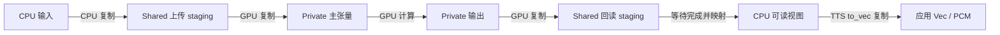

# macOS 统一内存：当前 Makepad / Burn 实现审计

2026-10-12。范围是本地 Makepad 的 ASR 和 Breeze-TTS-2；本轮只查源码、官方资料和设备能力，
没有修改推理、尝试量化、更新依赖或进行新的性能实验。

**结论：用到了统一物理内存的容量和访问优势，也已让主要计算数据常驻 GPU；但当前
Burn → CubeCL → wgpu Metal 路径仍通过 staging buffer 上传、回读，没有实现 CPU/GPU
对同一张量存储的直接交接。** 剩余优化应区分数据复制、同步等待和 GPU 内部访存，不能把
统一内存理解为自动消除这三种成本。

## 本机和实际执行路径

只读 Metal 探针返回 Apple M5 Max、128 GiB、`hasUnifiedMemory = true`。
原始记录：[设备能力](../artifacts/macos-unified-memory-research/metal-device.json)。

Makepad 的 [gpu.rs](../prototypes/makepad/src/gpu.rs) 在 macOS 明确选择 Burn Metal，
ASR/TTS 共用一次设备注册。本机锁定的是 Burn 0.21.0、CubeCL 0.10.0、wgpu / wgpu-core /
wgpu-hal 29.0.4，见 [Cargo.lock](../prototypes/makepad/Cargo.lock)。

当前 [Makepad 依赖](../prototypes/makepad/Cargo.toml) 启用 ASR 的 `native`、`metal`，
没有启用 `ane` / `coreml`；模型加载走普通 Burn 模型。因此，这条 UI 路径实际是 Metal GPU。
仓库中的独立 ANE 后端不能当作当前 Makepad 已在使用的推理设备。
核对记录：[实际 feature 树](../artifacts/macos-unified-memory-research/makepad-active-features.txt)。

Apple 说明，Apple GPU 的 shared 和 private 资源都使用系统内存；二者的关键区别是 CPU
能否直接访问。**private 并不意味着退回独立显存，也不意味着没用统一内存。**
shared 仍需遵守读写时序，GPU 专用中间结果也没有必要全部改为 CPU 可访问。
来源：[Apple 存储模式说明](https://developer.apple.com/documentation/metal/choosing-a-resource-storage-mode-for-apple-gpus)。

## 已经利用了哪些优势

| 环节 | 当前实现 | 作用和边界 |
|---|---|---|
| 模型权重、激活、KV | 主要计算数据以 GPU Tensor 保留 | 不会每个 token 把整个模型从 CPU 上传；GPU 常驻本身也是通用优化，并非 Apple 独有 |
| 权重加载 | safetensors 用只读 mmap，逐张量转换为目标 FP16 / FP32 后上传 | 避免先创建整模型 FP32 副本；文件映射仍不是 GPU 权重的同一份存储 |
| ASR 输出 | GPU 上先 argmax，CPU 每个文本 token 只取一个整数 | 已避免整个词表 logits 的回读；仍需等待 token 才能继续控制流程 |
| TTS depth | 默认 GPU 采样，15 个后续码字及 embedding 保留在设备上 | codec 直接使用设备码字；请求结束才集中回读报告码字 |
| TTS GEMV / RMSNorm | 直接使用现有设备权重和张量 | 没有新增每步权重上传或 CPU 回读；GEMV 也没有加载时复制整份重排权重 |
| 内存池 | CubeCL 管理主张量池和回读 staging 池 | 已有资源复用，不能把每次调用一概算成新建物理分配 |

代码：[权重加载](../src/weights.rs)、[ASR 解码](../src/stream.rs)、
[TTS 生成循环](../crates/breeze-tts/src/lib.rs)、[Metal depth](../crates/breeze-tts/src/metal_depth.rs)。
TTS 设备采样的条件是 `cpu_depth_sampling = false` 且 `top_p = 1`；CPU / top-p 回退会增加回读。

## 哪些地方还在复制

审计依赖版本对应的源码得到以下完整链路；下载的五份上游源码与本机 Cargo 源码逐文件
SHA-256 一致，见 [对照结果](../artifacts/macos-unified-memory-research/source-comparison.json)。

1. CubeCL 主张量池仅申请计算、复制等用途，没有 MAP_READ / MAP_WRITE；回读池单独申请
   MAP_READ。见 [CubeCL 内存池](https://github.com/tracel-ai/cubecl/blob/7cf203735e095e640a2c03b2400d0faa03196bb4/crates/cubecl-wgpu/src/compute/mem_manager.rs#L35)。
2. wgpu Metal 按映射用途选择 shared / private：上述主张量落到 private，回读 staging
   落到 shared。见 [Metal buffer 分配](https://github.com/gfx-rs/wgpu/blob/e99f5305ded96ff7006f0714d043a7f735bd45c2/wgpu-hal/src/metal/device.rs#L404)。
3. 回读明确执行 buffer-to-buffer copy，再提交并等待 map 完成。CubeCL 返回的 Bytes
   可以直接持有映射后的 staging；TTS 随后的 `to_vec` 又复制成应用拥有的 Vec。
   见 [CubeCL 回读](https://github.com/tracel-ai/cubecl/blob/7cf203735e095e640a2c03b2400d0faa03196bb4/crates/cubecl-wgpu/src/compute/stream.rs#L137)、
   [TTS PCM 回读](../crates/breeze-tts/src/codec.rs)。
4. 上传的 `queue.write_buffer` 在 wgpu 29.0.4 中先填充 staging，再向目标 buffer
   编码一次复制。CubeCL 注释中的“统一内存可能省去 staging”不能当作当前已经实现。
   见 [wgpu 上传](https://github.com/gfx-rs/wgpu/blob/e99f5305ded96ff7006f0714d043a7f735bd45c2/wgpu-core/src/device/queue.rs#L518)。
5. 更直接的证据是，CubeCL Metal 初始化主动排除了 `MAPPABLE_PRIMARY_BUFFERS`。
   该 native 能力允许主计算 buffer 使用映射用途，但当前设备没有启用它。
   见 [CubeCL Metal 初始化](https://github.com/tracel-ai/cubecl/blob/7cf203735e095e640a2c03b2400d0faa03196bb4/crates/cubecl-wgpu/src/backend/metal.rs#L19)。



这些缓冲区在本机都位于统一物理内存，图中的复制仍是真实的数据搬运和命令开销。
也不能只给整个内存池增加 MAP 标志就结束：wgpu 要求 buffer 在 CPU 映射期间不能被 GPU
使用，映射所有权覆盖整个 buffer，不能靠映射同一大池的另一小段绕过。CubeCL 回读池因此
使用独占页分配。来源：[wgpu 29.0.4 映射规则](https://docs.rs/wgpu/29.0.4/wgpu/struct.Buffer.html#mapping-buffers)。

## 数据量与等待成本

以下是由当前代码推导的**部分显式应用输入输出**，不是传输 trace。以 24 kHz、每帧
1920 样本、两帧一个 PCM 包、默认非 greedy 设备采样计算；单位按生成音频时长归一化，
不是按程序运行的墙钟时间。

| 路径 | 单次有效数据 | 每秒音频次数 | 每秒音频有效数据 |
|---|---:|---:|---:|
| 第一组 logits，GPU → CPU | 2052 × 4 = 8,208 B | 12.5 | 102,600 B，约 0.103 MB |
| 15 组 Gumbel 噪声，CPU → GPU | 15 × 2048 × 4 = 122,880 B | 12.5 | 1,536,000 B，约 1.536 MB |
| 单声道 FP32 PCM，GPU → CPU | 3840 × 4 = 15,360 B | 6.25 | 96,000 B，约 0.096 MB |

表中未计加载、mask、RoPE、uniform、对齐、最后 EOS 探测以及 GPU 内部权重/激活读写；
不能据此声称整个模型只使用这么多带宽。计算记录：
[transfer-payloads.json](../artifacts/macos-unified-memory-research/transfer-payloads.json)。

第一组 logits 仍在 [生成循环](../crates/breeze-tts/src/lib.rs) 中同步回读，CPU 完成随机采样和
EOS 判断后再上传 token；其余 15 个 depth token 默认没有这种逐码字往返。
[PCM 解码](../crates/breeze-tts/src/codec.rs) 也在回调前等待 GPU 结果。
这些小数据的带宽需求不大，但等待会切断命令提交与后续 CPU 工作的重叠。
Gumbel 还在 CPU 执行随机数和对数计算，这部分也不是单纯复制开销。

上一轮 stock + 强制同步诊断中，depth 每声学帧约 105 ms，backbone 约 16 ms，
semantic_sample 约 1.7 ms。它提示主要成本仍在 depth，但不等于 1.7 ms 都是复制，
也不能代表目前 GEMV/RMS 默认实现的精确耗时分布。
记录：[原阶段统计](../artifacts/tts-gemv-opt/long-stage-summary.json)、
[测量边界](breeze-tts-metal-depth-optimization.md)。

所以，**仅凭消除这些小缓冲区复制，不能推断当前 RTF 会降到 1 以下**。本轮没有测量
统一内存改造的提速比例，也没有测量是否已吃满本机带宽。CPU 占用也不能仅归因于 memcpy：
CubeCL 原生 poller 已使用 Wait、闲时 park，是否存在显著调度或轮询开销仍需采样分析。

## 与 MLX 的差别

MLX 明确把数组设计成不绑定 CPU/GPU 位置的共享存储，算子可以选择执行设备，跨设备依赖
由调度器处理。当前 Burn/Wgpu 的张量与主机数据仍通过上传/回读 API 交接，底层又有 staging。
因此可以说硬件优势已生效，但软件尚未提供同等程度的直接共享。
这不证明迁移整个模型到 MLX 会更快；其文档中的其他模型或算子的提升不能套用本项目。
来源：[MLX Unified Memory](https://ml-explore.github.io/mlx/build/html/usage/unified_memory.html)。

## 建议顺序

| 顺序 | 建议验证 | 判断依据与限制 |
|---|---|---|
| 1 | 分别统计复制字节/次数、提交次数、回读等待、CPU 调度时间 | 对当前默认 GEMV/RMS 路径测量；区分首包、稳态和长段，不用加入强制同步后的 RTF 代替正常吞吐 |
| 2 | 小范围对照第一组 GPU 采样，以及异步 PCM 回读/回调 | GPU 采样可把全 logits 回读缩到 token/EOS，但仍可能有标量同步；PCM 可尝试双/三缓冲交接，保留有界队列和停止响应 |
| 3 | 仅为经常交换的输入输出做 native shared buffer 原型 | 需要 CubeCL 层显式启用/检查映射能力、独立 buffer 生命周期、map/unmap 和完成事件；不应让映射一个输出阻塞整个张量池 |
| 4 | 若加载时间/峰值内存成为目标，再验证直接填充 shared 权重 | 当前已按目标 FP16 上传，空间小于“去掉整模型 FP32 副本”的错误假设；必须对照热推理是否回退 |

第 2 项改变 CPU/GPU 调度或采样归约顺序，需要检查固定种子、EOS、声音描述 CFG、参考克隆、
尾包和停止后的重启。把 RNG 移到 GPU 也需单独核对 SplitMix64 和 Gumbel 的精度，
不能把它当作必然保持相同码字的零风险修改。

第 3 项可借鉴 Apple 的多缓冲资源交接方法，但 ASR/TTS 的自回归依赖不会因为多缓冲而消失。
同一片内存写完再读仍需要同步，必须先证明存在可重叠的工作。
来源：[Apple CPU/GPU 同步示例](https://developer.apple.com/documentation/metal/synchronizing-cpu-and-gpu-work)。

Metal 也提供包装已有分配的 `bytesNoCopy` API，但要求页对齐、长度对应页对齐区域以及单一
VM 区域，调用方还必须保持内存生命周期。现有 safetensors 张量可能需要 dtype 转换、分片或
切片，不能直接把任意 `mmap` 子区间当成可用 GPU 权重。
来源：[Apple bytesNoCopy](https://developer.apple.com/documentation/metal/mtldevice/makebuffer(bytesnocopy:length:options:deallocator:))。

若目标是继续提高完整合成速度，depth 的融合和提交次数仍值得优先测量。固定 depth KV、QKV
合并和避免 KV head 重复在此前已经试过，未显示稳定整体收益；不能仅凭“统一内存”又将它们
设为默认。见 [先前实验结论](breeze-tts-streaming-optimization.md)。

## ANE 的边界

独立 [burn-ane 存储层](../crates/burn-ane/src/storage.rs) 已保留 IOSurface 输出句柄，部分原生
路径可以继续消费 surface；不是所有算子都必须绕 CPU。显式物化成 TensorData 时仍分配并读取
FP16 数组，[Direct.m](../crates/burn-ane/native/Direct.m) 的 host 接口也会执行布局转换和复制。

本轮没有发现当前 Makepad 使用这条路径，也没有验证 Metal 主张量与 ANE IOSurface 的直接
共享桥接。若未来要优化 CPU/GPU/ANE 交接，应单独讨论，不作为此次 TTS 内存优化的隐含变更。

本轮新增本报告及 [研究证据目录](../artifacts/macos-unified-memory-research)。
源码、现有二进制和受保护 ASR / ANE 文件的核对记录见
[unchanged-audit.json](../artifacts/macos-unified-memory-research/unchanged-audit.json)。


## FP16 共享张量与 ANE 优先接入

2026-10-12 第一阶段实现。上文记录实施前状态；本节保留当时严格 ANE 优先候选版的结果。
当前默认调度见本文最后的“混合后端的延迟调度优化”一节。
按照用户要求采用 FP16，不以所有算子提供 FP32 执行为准入条件，不使用整数或低比特量化。
Web 界面与推理流程没有新增优化。

### 执行与共享边界

Apple Silicon 上的 ASR、TTS、参考音色编码使用 `Ane<Metal>`。`ane_first = true`
让当前编译器支持的子图优先尝试 Direct ANE；不支持的 IR、编译失败的图由 Metal 执行，
失败原因可从日志的 `fallback_reasons` 查看。这里的“支持”指当前编译器能够表达并成功
执行该子图，不表示已经覆盖硬件所有潜在能力。例如 Conv1d、ConvTranspose1d、Sin、
Select 和 ArgMax 仍有 Metal 回退。模型计算没有改用 NdArray CPU 后端。

共享张量以 IOSurface 为实际分配，由 Metal `newBufferWithBytesNoCopy` 包装同一地址，
通过 wgpu Metal HAL 导入 CubeCL。详见 [Rust 交接实现](../crates/burn-ane/src/shared.rs)、
[原生桥](../crates/burn-ane/native/Direct.m)、[原生设备策略](../prototypes/makepad/src/gpu.rs)。

| 边界 | 实际处理 |
|---|---|
| ANE → ANE，布局和 padding 一致 | 将原 IOSurface 直接绑定为下一张图的输入 |
| ANE → Metal，FP16 且布局可表示为 strides | Metal Tensor 直接引用同一 IOSurface |
| ANE → Metal，需要消除分段 padding、重排或恢复公共 FP32 dtype | 在 Metal 上转换，不在 CPU 建立激活数组 |
| Metal → ANE | Metal 将激活排入 ANE 输入 IOSurface，完成后交给 ANE |
| CPU 请求最终 logits / PCM，或初始化权重 | 仍存在 CPU 数据访问、转换和上传 |

因此这是跨 ANE / Metal 的共享张量接入；布局转换、最终输出以及初始权重载入仍有复制。
没有把整个 CubeCL 私有内存池改成 Shared，也没有把统一物理内存等同于全面零拷贝。

Metal buffer 的析构块持有 Rust `Arc<Surface>`，直到最后一个 GPU 引用释放后才归还
输出表面。导入张量禁止自动原地写入，防止覆盖仍由 ANE 或另一个张量引用的内容。
GPU 写入输入表面后才等待 Metal 完成；纯 ANE 表面别名之间不增加空的 Metal 等待。
Direct ANE 的同步 evaluate 返回后，其输出才会交给 GPU 消费。

硬件地址探针确认 `same_address` 和 `metal_write_visible_to_iosurface` 均为 true：
[探针结果](../artifacts/apple-shared-ane/iosurface-buffer-probe.json)。

### FP16 数值处理

保留 Burn 公共 dtype 和形状契约；公共类型为 FP32 的图也可在 ANE 上以 FP16 执行，
回到 Metal 时由 GPU 完成所需的类型转换。补充识别 `x * reciprocal(sqrt(mean(x*x) + eps))`
及其交换乘数的归一化形式，使用整体归一化，避免显式物化溢出的 FP16 平方。

TTS 的 Gemma 残差原本可能超过 65504。残差流改以 1/16 存储，归一化 epsilon 同时
乘以 1/256，post-norm 权重在乘入激活之前缩小 16 倍，最终归一化恢复正常尺度。
这不修改检查点权重，也不更改模型的数学定义。纯 Metal 的英文 teacher-forced 对照
相对 RMSE 最大约 0.18%，落在原比较脚本的 0.5% 阈值内。

**ANE FP16 与原 Metal 路径并非数值等价。** 英文诊断中，投影后的文本特征相对 RMSE
约 21.6%，主干 / depth / continuation logits 约 1.2%–2.7%；逐层数据表明最终加权
归一化放大了中间误差。缩放解决表示范围问题，没有消除上述偏差。不能据此宣称与官方
Python 保持同等精度，需要结合实际合成与转写结果判断。
数据：[Metal 缩放对照](../artifacts/apple-shared-ane/trace-english-comparison-scaled-metal.json)、
[ANE 对照](../artifacts/apple-shared-ane/trace-english-comparison-scaled.json)、
[逐层对照](../artifacts/apple-shared-ane/text-layers-comparison.json)。

### 缓存与速度

ASR、TTS 共用一个加锁的 ANE 会话，统一管理 112 个已加载程序槽，按 LRU 更换，避免
为闲置引擎固定保留一半槽位。最多缓存 2048 个图；描述符和已打包权重分别按物理内存
的 1/8 分配预算，上限各 16 GiB，未知内存容量时各 2 GiB。这些预算不包含 GPU 模型张量、
原生运行时额外分配和全部 I/O 表面，不能当成进程 RSS 上限。

早期 2 GiB 缓存会反复淘汰 TTS 工作集；增加预算后，重复短请求没有继续回读和打包
大量权重。扩大单 token 融合的试验反而增加描述符和权重压力，已恢复分段图。
严格 ANE 优先仍受小图调用、输入排布、程序重载和同步限制，当前未达到实时合成速度。
共享内存生效不等于这个自回归模型必然在 ANE 上更快。

最终短样例使用相同进程、greedy、8 帧（0.64 秒音频）运行两次：首次载入模型 9.75 秒，
首次生成 27.80 秒；再次生成 8.09 秒、首包 2.68 秒，短样例 RTF 为 12.65。
第二次运行执行 3951 次 ANE 图，仅 925 次需要等待 Metal 写入，其余不增加空 GPU 等待。
这是工程 smoke，不是长音频吞吐基准；系统 ANE 编译缓存可能已经是热缓存。
详细计数见 [最终测量](../artifacts/apple-shared-ane/summary.json)。

实际设备播放也验证了这一限制：慢速生成时，自适应缓冲会等到 EOS 后才开始播放，
首声延迟明显。当前严格 ANE 优先不能当作原 Metal 版的性能替代。


### 验证与复现

当前真机验证包括 36 项既有 Direct ANE 测试、6 项共享 Metal 测试、27 组原生 I/O 和
165 组跨表面复制测试。覆盖 FP16 / 公共 FP32、CFG 两个 batch、非整齐行数、KV 增长与
截断、保留旧输出时重用图，以及极小 / 大幅值归一化。原生 C 测试通过
`-Wall -Wextra -Werror` 编译。

真实 ASR 样例 `aishell-test-0-0088` 输出“要继续开展商贸零售领域价格秩序整治。”，
与参考文字一致；累计 delta 与最终文字一致。该次记录中，139 次 ANE → Metal 交接
直接引用共享表面，ANE 输出的 CPU 物化次数为 0；这不包括最终 token 的正常 CPU 读取。
结果见 [ASR smoke](../artifacts/apple-shared-ane/asr-smoke.json)。

```sh
cargo test --manifest-path crates/burn-ane/Cargo.toml --release \
  --features metal-shared --test shared_metal -- --test-threads=1
cargo build --manifest-path prototypes/makepad/Cargo.toml --release --example apple-hybrid
# 8 是诊断帧数，不是界面录音 / 合成时长限制；2 表示同进程重复两次。
prototypes/makepad/target/release/examples/apple-hybrid tts '你好，欢迎使用本地语音合成。' 8 2
python3 prototypes/makepad/validate-tts.py \
  --binary target/apple-shared-ane/release/r2t2-makepad \
  --output artifacts/native-validation-new --device-output-muted
```

`[accelerator:asr/tts]` 输出进程会话累计统计。`shared_metal_inputs` 表示 GPU 排布输入，
`shared_native_aliases` 表示 ANE 表面直接复用，`shared_metal_outputs` 表示交给 Metal 的
表面，`shared_zero_copy_views` 是其中无需转换的视图，`shared_metal_synchronizations`
记录实际 GPU 写入后的等待次数。`native_materializations` 记录显式 CPU 物化，
`fallback_upload_bytes` 还包含初始化数据，不能直接解释成推理中的激活复制量。

Direct ANE 延续项目已有的私有接口实现；系统兼容性仍依赖运行时实际编译 / 执行结果。
这次实机是 Apple M5 Max、128 GiB、macOS 27.0.1。库补丁保留其他平台原有回退路径，
没有对其他平台作实机速度承诺。


原生界面第一轮完成了 17 项场景检查，含中英文 EOS、参考音色、带描述的克隆、音色
设计、候选音色重用、生成前停止和推理中停止。中文、英文、克隆以及两份音色设计
播放均完整排空，没有设备 underrun。旧测试只监听生成期间的播放事件，在慢速 ANE
直到 drain 才播放的情况下无法继续，主动中止后改为观察实际播放状态；
[第一轮报告](../artifacts/apple-shared-ane/native-ui/report.json) 明确标记为未完成，
不能记作完整脚本通过。

最终二进制另完成了 7 项加载、播放停止、重放停止、排空阶段停止、完整重放与 ASR
切换检查：[最终播放报告](../artifacts/apple-shared-ane/native-playback/report.json)。
实际播放 / 重放 / 排空时的停止分别约 53 / 64 / 63 ms；第一轮推理中停止约 0.66 s、
长 prefill 开始时停止约 0.11 s。此次没有运行额外的 30–60 秒长流检查。

保存的中文和英文合成结果也经原有 Metal ASR CLI 回听转写：英文还原目标句子；中文
在尾部增加 1 秒静音以补足 ASR lookahead 后，还原“你好，今天天气很好。”。
原始合成 WAV 保留不变。这只能证明所测样例的可识别性，不是大语料精度结论。
最后额外通过了原有 wasm32 ASR 库的编译检查。

交付的默认启动路径为 `./target/release/r2t2-makepad`，原 Metal 版本保留为
`./target/release/r2t2-makepad-metal`。原 ASR / TTS CLI 可执行文件未替换。
构建、源码、测试报告及二进制 SHA-256 见
[交付清单](../artifacts/apple-shared-ane/delivery.json)。

## 混合后端的延迟调度优化

2026-10-12，针对小图调用 / 程序重载、跨设备等待、Metal 自定义内核失效这三个问题。
本节的优化取代上节的默认严格 ANE 优先策略；共享张量及 Direct ANE 能力继续保留。
没有量化，也没有新增 Web 优化。

### 执行路径

1. 非 ANE 优先模式先检查计算规模，小矩阵及独立逐元素图直接提交到回退后端的惰性
   Fusion 队列，省去 ANE 图分析、分桶及缓存键构造。Makepad 的默认矩阵行数门槛为 8。
2. 新增 `AneDevice::fallback_scope()`，把一个依赖连续的阶段完整放在 Metal。
   路由按线程和设备隔离，嵌套作用域和异常退出都会恢复。Makepad 明确设置
   `prefer_fallback_phases = true` 启用模型阶段提示，独立库默认仍关闭，原有 ANE
   研究工具不会因此悄悄改成 Metal 解码。它会先处理已经提交的 ANE
   依赖；随后不为 Metal 操作增加 GPU 完成等待。实际发生 Metal → ANE 交接时，仍保留
   必需的共享存储写入完成同步。
3. 新增 `AneClient::fallback_float()`，允许 `Ane<Metal>` 通过惰性张量句柄继续调用
   原 Metal GEMV / RMS 内核。已有 ANE 激活走 IOSurface → Metal 句柄桥接，避免 CPU
   数组中转。拒绝跨会话、非浮点输入；严格模式和显式 ANE 优先模式保留各自策略。

TTS 的预填充、Transformer 和流式音频解码在本机对照中均选择 Metal，并完整保持在
该设备上。这是实测后的阶段选择，不能把这部分吞吐提高解释成 ANE 和 GPU 算力相加。
ASR 的文本预填充和后续 KV 解码也保持在 Metal；声学编码器与参考音色编码中的其他
子图仍使用同一个共享后端，按成本和支持情况路由。
库的 ANE 编译 / 计算内核没有通过降低精度来换速度，模型权重未改。

`OMNI_ANE_FIRST=1` 可用于复测严格 ANE 优先；`OMNI_ANE_MIN_ROWS` 可用于诊断行数门槛
（有效范围 1–2048）。这些都不是正常启动所需的设置。

### 分步对照与取舍

所有短样例均为同一句中文、FP16、贪心采样、8 帧 / 0.64 秒音频，使用同一进程中的
后续生成轮次观察热运行。帧数上限只属于诊断工具，没有给原生麦克风或播放增加时长限制。
旧严格 ANE 优先可执行文件已独立保留在 `artifacts/apple-hybrid-opt/baseline/`。

| 诊断阶段 | 热运行生成耗时 | 每轮 ANE 图 | 每轮程序重载 | 每轮 Metal → ANE 等待 |
| --- | ---: | ---: | ---: | ---: |
| 本轮重测的旧严格 ANE 优先 | 7.30 / 7.46 s | 3951 | 738 / 739 | 925 |
| 小图提前路由 + GEMV/RMS 桥接 | 1.17 / 1.07 s | 185 | 0 | 185 |
| 逐 token / 音频解码保持 Metal，预填充仍 ANE | 1.01 / 0.89 s | 132 | 0 | 132 |
| 短句完整保持 Metal 的阶段路由试验 | 0.60 / 0.57 s | 0 | 0 | 0 |
| 同批纯 Metal 对照 | 0.63 / 0.58 s | 不适用 | 不适用 | 不适用 |

同步分段计时另用于定位问题，没有混入上述吞吐成绩：混合路径的预填充约 0.406 s、
音频解码约 0.192 s，对应 Metal 约 0.034 s / 0.038 s。长文本预填充对照也没有发现
ANE 收益：重复测试句 12 次并生成 2 帧为 0.710 s 对 0.262 s；重复 40 / 80 次并
生成 1 帧分别为 0.931 / 1.340 s，对应 Metal 为 0.270 / 0.402 s。因此没有把“大图”
直接当作更适合 ANE 的证据。

以上为固定输入的工程样例，不是整个语料的平均 RTF，也不能推出所有流式合成都已经
达到实时。首轮仍包含模型上传、GPU 内核编译或 ANE 图编译；没有清空系统编译缓存，
因此首轮不代表彻底冷机测试。原始日志和分步数据保留在
[`artifacts/apple-hybrid-opt`](../artifacts/apple-hybrid-opt)。

ASR 验证还拦截了按小图切换的错误候选：在 AISHELL `0-0088` 上出现重复标点和
英文词插入，单纯把行数门槛从 8 提高到 64 不能修复。两份失败输出保留在
`asr-compare/`，不能把其耗时当作合格性能成绩。将文本解码器的预填充与 KV 更新
完整保持在 Metal 后，同一输入两轮均恢复“要继续开展商贸零售领域价格秩序整治。”。
声学编码器仍执行 ANE，热轮为 216 次 ANE 调用、183 次 Metal → ANE 等待、0 次
程序重载，生成耗时 3.436 s / 音频 5.361 s；同输入纯 Metal 为 1.720 s。
这说明修复后的混合版在该 ASR 样例上仍慢于纯 Metal，没有宣称混合执行必然更快。

原有 `asr-regression` 工具也改为获取 `gpu::device()`，避免在后端类型改为
`Ane<Metal>` 后，仍用 `Default::default()` 意外测试了另一套 Core ML / 缓存策略。

### 最终同输入对照

最终调度代码使用同一个诊断可执行文件串行运行混合后端和纯 Metal，没有同时运行
其他模型或编译任务。下表取各自首轮之后的中位数，短句 4 轮、其余 2 轮。
`first PCM` 是生成回调时间，不能当作扬声器实际首声时间。

| 输入 | 当前调度生成耗时 | 纯 Metal 生成耗时 | 当前 first PCM | 输出音频 |
| --- | ---: | ---: | ---: | ---: |
| 中文短句，贪心 8 帧 | 0.620 s | 0.613 s | 0.167 s | 0.64 s |
| 英文 + 音色描述 CFG，32 帧 | 2.837 s | 2.828 s | 0.221 s | 2.56 s |
| 长文本预填充，642 token，1 帧 | 0.409 s | 0.385 s | 0.407 s | 0.08 s |

短句相对本轮旧严格 ANE 优先的 7.379 s 中位数约快 11.9 倍。每一轮从 3951 次 ANE
图执行、925 次 Metal → ANE 等待、约 739 次程序重载，降至三项均为零；图分析计时也为
零。该路径实际执行了 7320 次原 GEMV 内核和 3000 次原 RMS 内核。它说明外层
`Ane<Metal>` 不再让 TTS 丢失已有 Metal 优化，不能据此声称 ANE 加快了这一段计算。
英文 CFG 的 RTF 仍约 1.108，长文本的一帧测试主要反映预填充成本，均不能证明任意
长句已经达到实时。原始输入、命令、二进制哈希和每轮数据见
[最终性能记录](../artifacts/apple-hybrid-opt/final-tts/manifest.json)。

三类输入的生成码字、样本数及峰值与纯 Metal 对照一致。另取英文 + 描述的
teacher-forced 路径，对文本、主干、depth 和继续生成共 7 组张量比较，最大相对 RMSE
为 0.17%，低于项目既有 0.5% 阈值；这不是逐元素完全相同或大语料精度结论。
见[数值检查](../artifacts/apple-hybrid-opt/final-numerical-checks.json)。

### 回归与播放

后端 88 项、TTS 12 项、ASR 库 11 项均通过，包括真实 ANE/Metal 共享输入、自定义
GEMV/RMS、严格模式、跨会话拒绝、线程隔离与异常退出恢复。原生界面相关单元测试
16 项通过，另一个需要音频设备的手动测试未在该单元测试命令中执行。

ASR 实际模型矩阵 70 项全部通过，覆盖停顿后尾字、单采样边界、静音、短句 EOF、
窗口滚动、噪声、44.1/48 kHz、停止后重启、分包和中英文。部分无尾部补齐的控制组
刻意保留缺字行为，用于验证补齐是否必要，不作为正确转写样本计分。
见[ASR 回归报告](../artifacts/apple-hybrid-opt/asr-matrix/report.json)。该矩阵运行期间
同时编译过原生应用，其计时不用于性能对照。

界面验收发现音色设计的候选 42 / 43 共用了时长历史：首个候选 4.00 秒使第二个
实际 5.76 秒的候选过早开播，出现一次约 0.78 秒设备间隙。现在无参考音频的候选按
采样种子隔离历史，时长缩短校准也需要至少 3 次长度可比的完整生成；慢样本立即
增大预估。参考音色继续按参考码字识别。中断或达到生成上限的结果不参与学习。
修复只影响缓冲等待，不改变采样率、音频内容或生成时长上限。

将失败场景的真实到达时间线在 16 / 24 / 44.1 / 48 / 96 kHz 回放，错误历史均能复现
断流，正确预估均无断流且保留所有帧，并仍在生成结束前开播。原有 48 条时间线的
240 组回放结果保持一致；原有一条非默认四帧输出场景的 0.49 秒间隙仍存在，未记作
本次修复。见[时间线检查](../artifacts/apple-hybrid-opt/playback-trace-summary.json)。

最终原生界面完整通过 24 项检查：加载与目录选择、WAV 输入输出、中英文生成、描述
CFG、参考克隆、候选设计 / 重用、停止、重放、排空以及 TTS 后切换 ASR 官方样例。
真实 48 kHz CPAL 回调下的 55.12 秒长段，全部样本播放完毕，断流、间隙和剩余缓冲
均为零；只有输出振幅在验收时被静音，模型、重采样和设备时钟都是真实路径。
该段生成耗时 86.11 秒，RTF 1.562，设备首声 38.13 秒，所以仍不是低延迟实时长句
合成。候选 43 的 5.76 秒音频也重新完整播放，间隙由约 0.78 秒降为零，首声从
3.66 秒推迟至 6.51 秒，连续性的收益来自更可靠的缓冲预估。
见[最终界面报告](../artifacts/apple-hybrid-opt/native-ui-final/report.json)。

默认启动路径 `./target/release/r2t2-makepad` 与
`./target/makepad-native/release/r2t2-makepad` 已更新为通过上述验收的构建。
原严格 ANE 优先二进制保存在 `artifacts/apple-hybrid-opt/baseline/`，原 Metal UI 和
ASR / TTS CLI 二进制均保留。源码、构建、测试、性能和二进制哈希见
[本轮交付清单](../artifacts/apple-hybrid-opt/delivery.json)。

复现核心对照与 ASR 矩阵：

```sh
python3 artifacts/apple-hybrid-opt/benchmark.py tts --output artifacts/hybrid-tts-recheck
python3 artifacts/apple-hybrid-opt/benchmark.py trace --output artifacts/hybrid-trace-recheck
python3 prototypes/makepad/validate-asr.py --suite matrix \
  --output artifacts/hybrid-asr-recheck \
  --runner target/apple-shared-ane/release/examples/asr-regression
python3 prototypes/makepad/validate-tts.py \
  --output artifacts/hybrid-ui-recheck \
  --binary target/release/r2t2-makepad --device-output-muted --long-stream
```
