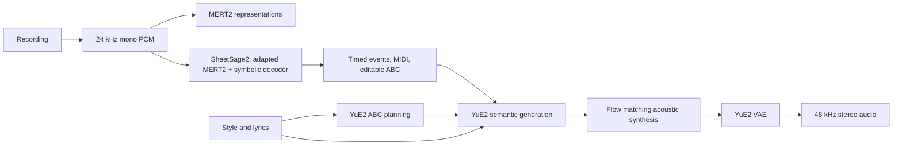

# YuE2 / MERT2 / SheetSage2 integration research

Source audit: 2026-10-14. This note records upstream behavior, checkpoint identities, and porting constraints. It does not claim that the Rust implementations or model inference have been validated.

The subsequent native implementation and measured checks are recorded separately in
[VALIDATION.md](../VALIDATION.md) and the [music module guide](../crates/omni-music/README.md).

## Which models implement the requested workflow

The supplied GitHub URL now hosts **YuE2**. Its original YuE implementation remains on the `YuE-v1` branch. The current release explicitly supports a recording → transcription → editable score → newly rendered song workflow and directly links SheetSage2 and MERT2. SheetSage2 is a real released model; substituting the older, unrelated implementation named SheetSage would be incorrect. [YuE repository](https://github.com/multimodal-art-projection/YuE/tree/1647252d68b70cbead046ffd3f7caf036dde47ee), [official cover workflow](https://github.com/multimodal-art-projection/YuE/blob/1647252d68b70cbead046ffd3f7caf036dde47ee/docs/covers.md)

| Model | Actual input | Actual output | Role |
|---|---|---|---|
| `m-a-p/MERT-v2-FullSong` | 24 kHz mono PCM | 25 Hz, 1,024-dimensional frame representations; optional 24 block states | General music representation; also the parent encoder for SheetSage2. [Model card](https://huggingface.co/m-a-p/MERT-v2-FullSong/blob/7001f7657276238629e61c7746ce70735e0604c0/README.md) |
| `m-a-p/SheetSage2` | A music recording or PCM waveform | Lead-sheet ABC, melody/chord MIDI, timed melody/chord/beat/key/structure events | Transcribes existing audio. It is not the text-to-score composer shown in the infographic. [Model card](https://huggingface.co/m-a-p/SheetSage2/blob/b83c3d79a6d98bcffaf8f9ed112c90aa887887bc/README.md) |
| `m-a-p/YuE2-3B` | Style, lyrics, optional supported ABC; `cot=full/melody/off` | Symbolic plan, semantic audio tokens, acoustic latents | Text-to-score composition and score-conditioned music generation. [Generation guide](https://github.com/multimodal-art-projection/YuE/blob/1647252d68b70cbead046ffd3f7caf036dde47ee/docs/generation.md) |
| `m-a-p/YuE2-Vae` | 64-channel acoustic latents | 48 kHz stereo waveform | Required audio decoder for the song generation path. [Configuration](https://huggingface.co/m-a-p/YuE2-Vae/blob/152733a19ad43aa67e367f9b5503ef8075bb5126/config.json) |

MERT2 itself provides embeddings, not ready-made genre, instrument, or mood labels. Its model card reports evaluations using separately trained probes. It does not accept MIDI or sheet music as direct model input. The public YuE2 song interface accepts ABC, not raw MIDI; a MIDI import feature would need a separate conversion into the supported ABC dialect. [MERT inference implementation](https://huggingface.co/m-a-p/MERT-v2-FullSong/blob/7001f7657276238629e61c7746ce70735e0604c0/modeling_mert2.py), [YuE2 request protocol](https://github.com/multimodal-art-projection/YuE/blob/1647252d68b70cbead046ffd3f7caf036dde47ee/src/yue2/protocol.py)

The two encoder uses in this diagram are distinct: standalone MERT2 exposes the original representation model, while SheetSage2 merges its own attention adapters into that encoder. A separate MERT feature-extraction pass is unnecessary for transcription. The handoff to YuE2 is ABC text; it is not an arbitrary embedding transfer. For covers, upstream recommends melody-only ABC and `cot="melody"`, retaining vocal and instrumental melody while allowing the new accompaniment to change. [SheetSage2 loader](https://huggingface.co/m-a-p/SheetSage2/blob/b83c3d79a6d98bcffaf8f9ed112c90aa887887bc/modeling_sheetsage2.py), [cover guide](https://github.com/multimodal-art-projection/YuE/blob/1647252d68b70cbead046ffd3f7caf036dde47ee/docs/covers.md)

## Checkpoint identities

The following revisions were returned by the official Hugging Face model APIs during this audit. Saved API responses and bounded HTTP Range reads of the safetensors headers are under `artifacts/music-upstream/`. The parameter totals below count stored tensor elements and can include buffers; the MERT manifest separately reports 632,295,808 trainable parameters. [MERT manifest](https://huggingface.co/m-a-p/MERT-v2-FullSong/blob/7001f7657276238629e61c7746ce70735e0604c0/weights_manifest.json)

| Repository | Revision | Stored elements / dtype | Weights |
|---|---|---|---|
| [SheetSage2](https://huggingface.co/api/models/m-a-p/SheetSage2) | `b83c3d79a6d98bcffaf8f9ed112c90aa887887bc` | 57,174,553 / F32 | Adapters, projection and decoder; parent encoder is additional |
| [MERT-v2-FullSong](https://huggingface.co/api/models/m-a-p/MERT-v2-FullSong) | `7001f7657276238629e61c7746ce70735e0604c0` | 632,429,312 / F32 | 2,529,812,848 bytes |
| [YuE2-3B](https://huggingface.co/api/models/m-a-p/YuE2-3B) | `8f24312f187763b9854adeec87e437e2b03bbff1` | 3,630,684,224 / BF16 | 7,261,441,640 bytes |
| [YuE2-Vae](https://huggingface.co/api/models/m-a-p/YuE2-Vae) | `152733a19ad43aa67e367f9b5503ef8075bb5126` | 132,616,130 / F32 | 530,512,720 bytes |

SheetSage2 pins its parent to MERT revision `d8ba1c745e733b3908ce6ad16ebeb17ac7600a42`, with `model.safetensors` SHA-256 `e6dd2ab187d6dd62b6521cd7d8f932e237acf0c5757745a7232082e28391350d`. The current MERT manifest reports that same weight hash; the adapter loader also verifies the parent implementation hashes. Preserve this pin instead of silently resolving `main`. [Sheet configuration](https://huggingface.co/m-a-p/SheetSage2/blob/b83c3d79a6d98bcffaf8f9ed112c90aa887887bc/config.json), [parent manifest](https://huggingface.co/m-a-p/MERT-v2-FullSong/blob/7001f7657276238629e61c7746ce70735e0604c0/weights_manifest.json)

YuE2-3B weight SHA-256 is `1d55c42c1a9875c34f5d736e15078449992b044e807ce2a138e6cf289a1e59e9`; the standard VAE hash is `807ce9d5149fa27c5ad3e6582058469852e908f6c5acc8c8aa338e7ab7751346`. The standard VAE is the listening decoder; `YuE2-Vae-legacy` is a separate benchmark decoder. [YuE manifest](https://huggingface.co/m-a-p/YuE2-3B/blob/8f24312f187763b9854adeec87e437e2b03bbff1/weights_manifest.json), [VAE manifest](https://huggingface.co/m-a-p/YuE2-Vae/blob/152733a19ad43aa67e367f9b5503ef8075bb5126/weights_manifest.json), [decoder selection guide](https://github.com/multimodal-art-projection/YuE/blob/1647252d68b70cbead046ffd3f7caf036dde47ee/docs/generation.md)

## MERT2 port requirements

The frontend uses a power spectrogram with FFT/window 2,048 and hop 240 at 24 kHz, 128 mel bins, power-to-dB conversion without a top-dB clamp, and checkpoint-specific mel mean/std. It removes the final time frame. Waveforms must not be standardized. ConvNeXt subsampling produces 25 Hz features, followed by 24 bidirectional Conformer blocks with width 1,024, 16 attention heads, FFN 4,096, rotary base 10,000, and depthwise convolution kernel 31. [Configuration](https://huggingface.co/m-a-p/MERT-v2-FullSong/blob/7001f7657276238629e61c7746ce70735e0604c0/config.json), [frontend and encoder source](https://huggingface.co/m-a-p/MERT-v2-FullSong/blob/7001f7657276238629e61c7746ce70735e0604c0/modeling_mert2.py)

Standalone MERT handles different valid audio lengths separately, because convolution and global response normalization otherwise include another sample's padding. Its attention is bidirectional, so causal decode-cache techniques do not directly replace this computation. The native port should preserve input lengths and use the existing bidirectional attention implementation where compatible. The last sentence is an implementation inference from the model source. [Encoder forward method](https://huggingface.co/m-a-p/MERT-v2-FullSong/blob/7001f7657276238629e61c7746ce70735e0604c0/modeling_mert2.py)

## SheetSage2 port requirements

The loader merges rank-64 LoRA adapters into all four attention projections of all 24 MERT layers, with `W += (B @ A) * (128 / 64)`, in CPU float32 before any precision cast. A learned softmax over 25 weights mixes the subsampler output and all 24 Conformer outputs; a 1,024 → 512 projection produces decoder memory. Do not mutate the standalone MERT instance when producing this adapted encoder. [SheetSage2 model implementation](https://huggingface.co/m-a-p/SheetSage2/blob/b83c3d79a6d98bcffaf8f9ed112c90aa887887bc/modeling_sheetsage2.py)

The symbolic decoder is BART: six layers, width 512, eight heads, FFN 2,048, GELU, learned positional embeddings, vocabulary 31,678, and maximum output length 5,120. Input and output token embeddings are tied. **Every input window is padded to 300 seconds, producing 7,500 encoder frames; encoder self-attention and decoder cross-attention include that silence.** Shortening the encoder context or applying a padding mask would change released-model behavior. [Configuration](https://huggingface.co/m-a-p/SheetSage2/blob/b83c3d79a6d98bcffaf8f9ed112c90aa887887bc/config.json), [audio preparation and decoding](https://huggingface.co/m-a-p/SheetSage2/blob/b83c3d79a6d98bcffaf8f9ed112c90aa887887bc/modeling_sheetsage2.py)

BART's learned positions have an offset of two, explaining the checkpoint's `[5122, 512]` position table. Its decoder layers normalize after the attention/FFN residual additions; they are not interchangeable with a pre-normalized decoder block. The checkpoint stores the shared embedding once as `token_embedding.weight`. The exact dependency source is saved locally as `artifacts/music-upstream/transformers-4.45.2-modeling_bart.py`. [Transformers 4.45.2 BART implementation](https://github.com/huggingface/transformers/blob/v4.45.2/src/transformers/models/bart/modeling_bart.py), [checkpoint](https://huggingface.co/m-a-p/SheetSage2/tree/b83c3d79a6d98bcffaf8f9ed112c90aa887887bc)

Full transcription selects prompts `timestamp`, `downbeat_meter`, `structure`, `key`, `chord_full`, `melody_full`; their canonical decoder prefix is `[1, 4, 5, 6, 7, 9, 11, 3]`. Decoding uses greedy argmax after a state-dependent grammar mask. Long recordings use 300-second windows with default 200-second overlap and 100-second lookahead; accepted event prefixes supply the next window's symbolic context. The paper preset instead uses 100-second overlap and no lookahead. [Generation implementation](https://huggingface.co/m-a-p/SheetSage2/blob/b83c3d79a6d98bcffaf8f9ed112c90aa887887bc/generation_sheetsage2.py), [whole-song pipeline](https://huggingface.co/m-a-p/SheetSage2/blob/b83c3d79a6d98bcffaf8f9ed112c90aa887887bc/pipeline_sheetsage2.py)

The static vocabulary has been exported to `artifacts/music-upstream/SheetSage2/tokenizer-schema.json` by extracting the official constants, then recomputing the upstream fingerprint. It matches `5ba3325af0344c7f`. This file contains the 361 chord labels, 192 meters, 23 structure labels, 24 durations, prompt IDs and ranges; using this data does not require Python inference. [Tokenizer source](https://huggingface.co/m-a-p/SheetSage2/blob/b83c3d79a6d98bcffaf8f9ed112c90aa887887bc/tokenization_sheetsage2.py), [schema definition](https://huggingface.co/m-a-p/SheetSage2/blob/b83c3d79a6d98bcffaf8f9ed112c90aa887887bc/schema_sheetsage2.py)

| Token group | Start inclusive | End exclusive |
|---|---:|---:|
| Reserved prompt block | 4 | 260 |
| Subbeat shift | 260 | 517 |
| 10 ms timestamp | 517 | 30517 |
| Meter | 30517 | 30709 |
| Eighth-note position | 30709 | 30965 |
| Structure | 30965 | 30988 |
| Key | 30988 | 31012 |
| Major/minor chord | 31012 | 31037 |
| Full chord | 31037 | 31398 |
| Pitch / voice | 31398 | 31654 |
| Duration | 31654 | 31678 |

These ranges are derived from the frozen tokenizer schema. IDs 0, 1, 2, 3 are pad, start, end, and output separator. Pitch IDs encode MIDI pitch modulo 128, with the upper half indicating the instrumental voice. Timestamp anchors map event subbeats to seconds through interpolation; duration tokens index discrete subbeat lengths. [Tokenizer](https://huggingface.co/m-a-p/SheetSage2/blob/b83c3d79a6d98bcffaf8f9ed112c90aa887887bc/tokenization_sheetsage2.py), [time interpolation](https://huggingface.co/m-a-p/SheetSage2/blob/b83c3d79a6d98bcffaf8f9ed112c90aa887887bc/generation_sheetsage2.py)

### Score and MIDI are separate outputs

Upstream MIDI preserves timed note events and exports `Vocal` and `Ins` tracks plus optional chord accompaniment. ABC reconstruction additionally infers measures from downbeats, subdivides every beat into four intervals, quantizes notes, resolves key/chord spelling, and rejects overlapping monophonic notes. A successful token/MIDI result does not imply successful ABC reconstruction. Keep partial events and MIDI available when notation fails. [MIDI playback implementation](https://huggingface.co/m-a-p/SheetSage2/blob/b83c3d79a6d98bcffaf8f9ed112c90aa887887bc/midi_sheetsage2.py), [export handling](https://huggingface.co/m-a-p/SheetSage2/blob/b83c3d79a6d98bcffaf8f9ed112c90aa887887bc/exports_sheetsage2.py)

The supported ABC representation has `X`, `T`, `M`, `L`, `Q`, `K` headers and two declared voices named `Vocal` and `Ins`. Unit length is the reciprocal of the least common multiple of four times the measure denominators. Tempo is total quarter notes divided by elapsed seconds, multiplied by 60 and rounded. Chords appear only in the Vocal voice; melody-only output excludes them. Integer note lengths are split into parser-supported values, with ties for held notes. Pickup and final partial measures use explicit rest padding. Meter/key changes apply to both voices. Missing or inconsistent rhythm must be reported, not replaced with an invented fixed meter. [ABC reconstruction implementation](https://huggingface.co/m-a-p/SheetSage2/blob/b83c3d79a6d98bcffaf8f9ed112c90aa887887bc/notation_sheetsage2.py)

## YuE2 port requirements

The released checkpoint uses 28 transformer layers, width 2,048, 16 query heads, eight KV heads, head dimension 128, FFN 6,144, vocabulary 184,704 and context 24,576. It combines autoregressive and non-autoregressive parameter paths rather than being a conventional text decoder followed by an unrelated diffusion model. [YuE2 configuration](https://huggingface.co/m-a-p/YuE2-3B/blob/8f24312f187763b9854adeec87e437e2b03bbff1/config.json), [model implementation](https://github.com/multimodal-art-projection/YuE/blob/1647252d68b70cbead046ffd3f7caf036dde47ee/src/yue2/modeling_yue2.py)

The execution boundary is `plan → generate_semantic → synthesize → decode`. The unchanged generated plan must retain its exact ABC token IDs, because decoding and re-encoding can alter the prefix. External edited ABC is a new input. Generation cancellation is checked between stages and during autoregressive generation/acoustic synthesis. Outputs retain independent truncation flags for ABC and semantic generation; playable audio alone does not prove the requested composition completed. [Pipeline implementation](https://github.com/multimodal-art-projection/YuE/blob/1647252d68b70cbead046ffd3f7caf036dde47ee/src/yue2/pipeline.py)

Prompting uses the checkpoint's Qwen tiktoken vocabulary and dedicated ABC/music/latent special tokens. Acoustic synthesis uses midpoint integration with 32 steps by default, operating on 64-channel latents. The VAE upsamples by 1,920 to 48 kHz stereo; upstream tiled decoding uses 1,024-frame cores and 16-frame halos, with deterministic cropping rather than an arbitrary crossfade. Its convolution weight normalization and SnakeBeta activation must be preserved. [Prompt and defaults](https://github.com/multimodal-art-projection/YuE/blob/1647252d68b70cbead046ffd3f7caf036dde47ee/src/yue2/protocol.py), [acoustic synthesis](https://github.com/multimodal-art-projection/YuE/blob/1647252d68b70cbead046ffd3f7caf036dde47ee/src/yue2/nar.py), [VAE implementation](https://github.com/multimodal-art-projection/YuE/blob/1647252d68b70cbead046ffd3f7caf036dde47ee/src/yue2/modeling_vae.py)

## Platform and dependency evidence

Upstream's supported starting point is Linux, Python 3.12 and an NVIDIA GPU with BF16 support and 24 GB VRAM, one request at a time. However, the Python pipeline explicitly selects MPS when available and contains a grouped-query-attention fallback for MPS. That establishes an intended portable execution path, not measured Apple Silicon parity or performance. No CPU/Metal inference was run as part of this research. [Generation guide](https://github.com/multimodal-art-projection/YuE/blob/1647252d68b70cbead046ffd3f7caf036dde47ee/docs/generation.md), [device selection](https://github.com/multimodal-art-projection/YuE/blob/1647252d68b70cbead046ffd3f7caf036dde47ee/src/yue2/pipeline.py), [MPS attention fallback](https://github.com/multimodal-art-projection/YuE/blob/1647252d68b70cbead046ffd3f7caf036dde47ee/src/yue2/modeling_yue2.py)

YuE2 0.1.6 pins Torch 2.10.0, Transformers 4.57.6 and tiktoken 0.12.0. SheetSage2 pins Torch/Torchaudio 2.8.0 and Transformers 4.45.2, alongside NumPy, SciPy, mir_eval and MIDI libraries. The official cover instructions require separate environments and recommend sequential transcription and generation. Optional score rendering uses abcjs/Chromium; optional piano audio uses separate sample assets. These Python/rendering dependencies belong to the reference implementation and do not by themselves require a Python runtime in omni-rs. [YuE package](https://github.com/multimodal-art-projection/YuE/blob/1647252d68b70cbead046ffd3f7caf036dde47ee/pyproject.toml), [Sheet requirements](https://huggingface.co/m-a-p/SheetSage2/blob/b83c3d79a6d98bcffaf8f9ed112c90aa887887bc/requirements.txt), [rendering implementation](https://huggingface.co/m-a-p/SheetSage2/blob/b83c3d79a6d98bcffaf8f9ed112c90aa887887bc/rendering_sheetsage2.py)

Inference for this project: a complete native integration requires the MERT frontend/Conformer, SheetSage BART decoder and symbolic grammar, deterministic score/MIDI conversion, YuE AR/NAR backbone and VAE. Existing generic attention, safetensors loading and inference lifecycle code can provide reusable primitives, but none of the three checkpoints can be represented accurately by only registering a model name or attaching a generic text-generation endpoint.

## License records

The YuE repository labels its code, documentation and agent skill Apache 2.0. YuE2 weights use CC BY-NC 4.0 with additional creator permission; the published terms distinguish personal creators who may monetize outputs, noncommercial academic use and company commercial use. MERT2 and SheetSage2 model cards identify their weights as CC BY-NC 4.0. Keep these model-specific records with downloads instead of treating every asset as Apache-licensed. [YuE license overview](https://github.com/multimodal-art-projection/YuE/blob/1647252d68b70cbead046ffd3f7caf036dde47ee/README.md#license), [YuE weight terms](https://github.com/multimodal-art-projection/YuE/blob/1647252d68b70cbead046ffd3f7caf036dde47ee/MODEL_LICENSE), [MERT license](https://huggingface.co/m-a-p/MERT-v2-FullSong/blob/7001f7657276238629e61c7746ce70735e0604c0/LICENSE), [Sheet license](https://huggingface.co/m-a-p/SheetSage2/blob/b83c3d79a6d98bcffaf8f9ed112c90aa887887bc/LICENSE)

VAE code incorporates Oobleck/stable-audio-tools and SnakeBeta/BigVGAN components under their original MIT notices. Sheet rendering assets have separate abcjs, font and piano-sample notices. [YuE third-party notices](https://huggingface.co/m-a-p/YuE2-Vae/blob/152733a19ad43aa67e367f9b5503ef8075bb5126/THIRD_PARTY_NOTICES.md), [Sheet third-party notices](https://huggingface.co/m-a-p/SheetSage2/blob/b83c3d79a6d98bcffaf8f9ed112c90aa887887bc/THIRD_PARTY_NOTICES.md)

## Local research artifacts

- `artifacts/music-upstream/YuE/`: reviewed official Python source, package manifest, license and workflow guides. The attempted archive download timed out; this is a targeted source snapshot, not a Git checkout.
- `artifacts/music-upstream/{SheetSage2,MERT-v2-FullSong,YuE2-3B,YuE2-Vae}/`: official configs, model cards, implementation files, dependency/license notices and weight manifests when supplied upstream.
- `*-api.json`: official model metadata captured during this audit.
- `tensor-header.json` in each model directory: bounded reads of actual checkpoint tensor names, shapes, dtypes and byte offsets; these files are not model weights.
- `SheetSage2/tokenizer-schema.json`: deterministic static schema export, verified against the configured vocabulary fingerprint.

Only these research sources, metadata and this note were produced by the research task. Runtime integration, weight downloads, numerical comparisons, audio listening and end-to-end HTTP/UI validation remain implementation work.
