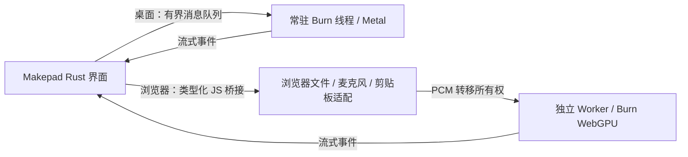

# Makepad 本地版与已有 Web 原型


原生界面集中为两个工作台：

- **语言**：左栏转写与翻译，右栏朗读、翻译、参考克隆与音色设计；转写和译文可直接“送去朗读”。
- **创作**：左栏音乐风格、歌词与歌曲生成，右栏图像描述、参考图编辑与预览。参考音乐、ABC 乐谱和模型目录可按需展开。

默认 1000×810 双栏展示，窗口窄于 900 时改为上下排列。切页、展开设置和调整窗口保留草稿与已有结果。全局停止位于滚动区域外。转写仍启动加载，语音合成和图像通过各自“载入模型”显式加载，音乐按所执行的动作载入。


同一份 Rust 界面接入完整的 Confucius4-R2T2 / Burn 推理。用于验证技术选型，支持模型加载、WAV 文件、默认麦克风、输入电平、流式文字更新、手动打断、速度档位、复制全文、中文提示词和推理期间的界面操作。尚未提供安装包、模型下载管理或移动端布局。

语言工作台的 ASR、TTS 两栏均提供 Hy-MT2-7B 翻译按钮、目标语言、停止和模型目录选择。
先运行 `python3 scripts/download_hy_mt.py`，首次翻译会自动载入模型；也可用 `HY_MT_MODEL_DIR` 指定目录。
ASR 保留原始转写，TTS 在点击“用译文朗读”后将译文填入朗读文本，再点击合成。
两个入口共用翻译模型及 Radix 前缀缓存。浏览器通过[本地 Web API](../../README.md#本地-web-api)使用同样的翻译能力。

模型加载和推理共用一个执行名额。运行时可以切页、编辑下一次输入、复制文字和保存上一次完成的音频或图片。
顶部显示当前任务，“停止推理”在任意页面均可使用，也会撤销冷加载后待续跑的翻译。
模型加载在张量读取及阶段之间检查取消；当前设备运算结束后返回。语音与图像只在显式点击“载入模型”后加载，
缺失模型会在所属工具中显示“选择模型”与“重试加载”；转写保留启动时的目录恢复流程。
TTS 生成完成后会释放推理名额；尾音播放和再次试听可与另一模型推理并行，顶部“停止播放”单独控制声音。
保存使用点击时的已完成结果快照，下一次生成不会改变正在导出的文件。

## 音乐创作

“创作”工作台的音乐区提供 **MERT2 → SheetSage2 → YuE2** 工作流，直接调用 `omni-music`，无需 Web 服务。
先用 `scripts/download_music.py` 准备四份权重。默认父目录为 `models/`，其中包含
`MERT-v2-FullSong`、`SheetSage2`、`YuE2-3B` 和 `YuE2-Vae`；可在页面选择父目录或设置
`MUSIC_MODELS_DIR`。成功运行后记住目录，`MUSIC_SETTINGS_PATH` 可指定独立设置文件。
打开创作工作台不会加载音乐权重；点击提取特征、转谱或生成时，仅加载所需模型，各阶段结束后释放。

1. 选择 WAV，提取 1,024 维音乐特征，或转为旋律/旋律与和弦。分析最长六分钟，转谱最长五分钟。
2. 查看、编辑 ABC，打开“使用此乐谱”后生成歌曲。转谱期间修改输入会保留编辑器内容，
   可用“载入转谱结果”取回刚完成的乐谱。ABC 转换失败仍可保存转谱事件和 MIDI。
   “保存当前 ABC”导出编辑器内容；“转谱 MIDI/事件”导出原始转谱，不随 ABC 编辑而改变。
3. 填写风格和歌词，设置时长上限（1–480 秒）与随机种子，再生成歌曲。
   关闭“使用此乐谱”可直接从文字创作。时长上限限制生成 token 数，达到上限会明确提示片段可能不完整。
4. 试听或保存 **48 kHz 双声道浮点 WAV**，也可保存包含原始请求、乐谱和截断标记的生成记录。
   试听按输出设备采样率转换，并保留左右声道；单声道设备会混合两路。

音乐与其他模型共用推理名额，切页后仍可用顶部“停止推理”。试听不占推理名额，
顶部“停止播放”可停止音乐；启动 TTS 或音乐试听会停止另一种播放。失败、取消不会替换上一份已完成结果。
音乐特征只提供向量，不输出风格/情绪分类。乐谱仍需人工检查，模型细节见[音乐模块](../../crates/omni-music/README.md)。

原生音乐回归（真实权重、测试自有隐藏窗口、静音的实际音频设备回调）：

```sh
python3 prototypes/makepad/validate-music.py --output artifacts/native-music-check
# 仅检查入口和默认窗口画面，不跑音乐模型：
python3 prototypes/makepad/validate-music.py --smoke --output artifacts/native-music-smoke
```

完整回归使用 `artifacts/music-validation/composition.wav`，覆盖转谱编辑保护、模型缺失恢复、
两种歌曲生成、导出回读、跨页停止、取消/失败后保留输出和双声道试听。结果保存在输出目录的 `report.json`。

2026-10-11 起以 Makepad 本地版为优化主体，Web 保持已有实现。当前本地版加入预计算重采样、
数据通知唤醒、按需文本刷新和官方库后处理；ANE 推理实现未改。
CPU 对照、Python 行为差异及 Whisper 社区策略取舍见[本地流程优化](../../docs/native-pipeline-optimization.md)。

Makepad 固定在 [`711521d`](https://github.com/makepad/makepad/tree/711521dbfaba2d04be4d88176deef367f33d9ed3)，使用当前 2.0 的 `script_mod!`，不混用旧版 `live_design!` API。原型是独立 Cargo workspace；复用根项目推理和重采样实现，Web 额外导出 `WebResampler` 与可独立调用的 `WebStopHandle`。

## 运行原生版

默认模型位于 `models/Confucius4-R2T2`；已有模型放在其他位置时，可在启动后选择所在目录。下载方法见[根目录 README](../../README.md)。官方样本位于 `artifacts/Confucius4-R2T2-upstream/resources/test.wav`。在仓库根目录执行：

```sh
python3 prototypes/makepad/build-native.py
./target/makepad-native/release/r2t2-makepad
```

本地版启动后自动加载 `models/Confucius4-R2T2`，显示加载阶段和进度条，无需点击“准备模型”或“载入模型”。进度按加载阶段和模型层数推进，不代表耗时百分比。显示“模型已就绪”后，点击“麦克风”实时录音，或“开始转写”识别文件。

找不到模型或缺少文件时，会弹出系统目录选择窗口。选择包含 `config.json`、`tokenizer.json` 和 `model.safetensors`（或分片索引及全部分片）的目录；macOS 也可直接选择其中的模型文件。取消后可再次选择，文件损坏导致的加载失败可以修复后“重试加载”。成功加载后才记住选择，下次启动自动使用该目录。macOS 设置保存在 `~/Library/Application Support/omni-r2t2/settings.json`。开发和自动化可以通过 `R2T2_MODEL_DIR` 覆盖启动目录、`R2T2_SETTINGS_PATH` 指定独立设置文件；正常启动不需要设置环境变量。

可以粘贴其他 WAV 的完整路径；整数/浮点 WAV、多通道平均、16 kHz 重采样都在工作线程完成，原型限制最长 10 分钟。首次推理包含 GPU 内核编译，重复转写用于观察预热速度。提示词仅在开始一个新会话时读取。Web 保留原来的手动加载交互。

Apple Silicon 原生界面使用 `Ane<Metal>`，默认按延迟选择执行路径。短矩阵和独立逐元素图提前交给 Metal；M5 上实测更快的 TTS 预填充、逐 token 解码和流式音频解码完整留在 Metal，并保留原 GEMV/RMS 内核。ASR 的文本预填充和 KV 解码也保持在 Metal，声学编码器仍可执行 ANE。ASR、TTS 和参考音色编码共用有界 ANE 程序缓存及 Metal 设备；实际跨设备时仍通过 IOSurface 共享激活，必要的布局转换在 GPU 完成。实现和实测见 [调度优化记录](../../docs/macos-unified-memory-research.md#混合后端的延迟调度优化)。开发诊断可用 `OMNI_ANE_FIRST=1` 恢复支持即交给 ANE 的策略，正常启动无需设置。

Intel Mac 使用 Metal，其他原生平台编译为 Burn WGPU，Web 继续使用 WebGPU。本次实测机器是 Apple M5 Max，其他操作系统尚未实机验证。Makepad 自己负责界面渲染，模型常驻工作线程，命令队列有界，界面通过 `try_send` / `try_recv` 和 `SignalToUI` 通信。停止通过原子标志打断推理，当前执行的运算返回后退出，保留模型供下一次任务使用。

此命令运行开发用的独立可执行文件。西文字体来自 Cargo 的 Makepad checkout；界面自带的字体、覆盖的文字和许可见 [resources/fonts/README.md](resources/fonts/README.md)。它不是可单独分发的 `.app` 安装包。
原生 UI 使用独立的 `target/makepad-native`，避免与根 workspace 的 Burn 特性构建产物冲突。

## 语音合成

“语言”工作台右栏提供 Breeze-TTS-2，点击“载入模型”后加载 `models/Breeze-TTS-2`，
缺少文件时选择模型目录，成功后记住位置。文本和可选声音描述在提交时读取，点击
“合成并播放”开始流式生成，点击“停止”静音并取消后续生成；完整或中断的音频均可保存为 WAV。
播放会根据生成速度自动积累缓冲，优先保证连续性；界面区分“正在缓冲”和“正在播放”，
“首声”按音频设备开始输出的时间统计。生成慢于实时的时候需要多等一段首声，
仍可在缓冲、播放或生成结束后的尾音播放期间随时停止。
时长历史按音色和语言隔离，音色设计的不同候选也分别记录；至少完成 3 次长度相近的
合成后才允许据此缩短预估，避免一个短候选使下一个候选过早播放。
本地 GPU 模型、声学解码器及音频输出都在 Rust 内执行。当前支持中英文和声音描述；
声音克隆可选择参考 WAV 并填写对应文字；参考编码会缓存，支持停止和清除参考。Web 保持已有 ASR。
“音色设计”可按文字描述生成试听，切换候选或重复试听，并将完整设计结果直接选作参考音色继续朗读。
已选用音色保留在当前会话内；保存试听 WAV 和对应原文可在下次作为参考载入。
模型准备、许可、CLI、实测性能与数值对照见
[Breeze-TTS-2 接入说明](../../docs/breeze-tts.md)。

## 麦克风操作

1. 载入模型后点击“麦克风”。应用读取系统默认输入设备，首次使用需允许系统或浏览器的录音权限。看到“录音中”和变化的电平后开始说话。
2. 界面显示采集时长、待处理时长与输入电平，文字随推理逐段出现。音频只在本机处理，不上传到转写服务。待处理音频使用本地临时缓存，读后删除，停止或正常结束后清理整个会话缓存。
3. 点击“停止”立即释放输入设备、取消积压与未确认尾音，保留已确认文字；推理退出后可再次录音。音源自然结束时仍会处理尾音，此时也可点击停止打断。提示词在下一次会话开始时读取。

原生用 CPAL / CoreAudio，独立线程拥有输入流。回调将各通道平均写入预分配的无锁环形缓冲，不进行 GPU 运算、内存分配或阻塞等待。采集线程可独立于 GPU 停录；连续 5 秒没有收到输入数据会退出并提示检查权限/设备。原生从终端启动时，请检查“系统设置 → 隐私与安全性 → 麦克风”中的终端权限。

本地重采样器预计算重复使用的 sinc 滤波系数，支持变长分包与自然结束的尾部刷新。
转写线程等待数据/结束通知；诊断全文日志默认关闭，需要时设置 `R2T2_TRACE_EVENTS=1`。

说话停顿时，完整识别候选若在至少 800 ms 的后续音频中保持不变，会提交此前保留的尾字，
录音继续。均衡档按 320 ms 更新，通常需 3 次相同候选确认。它复用现有解码，不按音量阈值
切掉静音，也不自动结束录音；候选变化时重新确认。
文件或测试音源正常结束时，最后一次解码会补足 640 ms 的数字静音上下文，已有的尾部零样本计入其中。
这部分上下文不计入录音时长，也无需按实时时钟等待；手动停止仍立即取消未确认尾音。
这项策略仅由本地麦克风启用，细节及 `IMKCFRunLoopWakeUpReliable` 日志说明见
[本地流程优化](../../docs/native-pipeline-optimization.md)。

Web 优先使用 AudioWorklet。若接口缺失、加载失败或 5 秒内未返回，则使用 `ScriptProcessorNode` 兼容采集，界面会显示“兼容采集”。此 API 已弃用，保留为浏览器兼容适配；在主线程繁忙时可靠性较低，检测到音频回调时间缺口会提示“采集曾延迟，可能漏字”并继续录音，直到手动停止；无法恢复已经缺失的硬件样本。支持情况见 [MDN](https://developer.mozilla.org/en-US/docs/Web/API/ScriptProcessorNode)。两种输入适配均使用同一分包器；Burn 推理始终在独立 Worker 中运行。

持续录音没有固定时长或推理积压秒数上限。原生采集线程把 PCM 写入私有临时目录的分段文件；Web 使用同源 IndexedDB，Worker 每次拉取一个数据包。采集端的信用额度在临时存储完成后返还，与 GPU 推理速度无关，内存中的传输缓冲保持有界。磁盘/浏览器配额耗尽、设备中断仍会报告错误；浏览器/进程异常崩溃可能留下临时缓存，不能保证异常退出后的清理。

两端使用实际采样率进行 16 kHz 单声道重采样。Web 优先创建 16 kHz AudioContext，降低数据量；不支持时使用设备默认采样率。80 ms 分包减少消息与存储事务数量。公开文件测试音源自然结束时，兼容采集会排空 Web Audio 双缓冲，可能包含短静音尾部；手动停止直接取消。

### 速度档位

点击速度按钮循环切换，下一次识别生效：

| 本地档位 | 音频分块 / 前瞻 | 每块 token 预算 | 选择 |
|---|---|---|---|
| 均衡 | 320 / 160 ms | 8 | 本地默认 |
| 低延迟 | 160 / 160 ms | 4 | 手动选择 |
| 快速 | 960 / 0 ms | 8 | 手动选择 |
| 省算力 | 1280 / 0 ms | 12 | 手动选择 |

较大音频块减少未完成编码窗口和解码前缀的重复计算，代价是文字更新间隔变长。均衡档首次积累 480 ms 音频，低延迟档为 320 ms；实际出字还需推理与确认时间，不能当作首字延迟承诺。模型权重仍为 FP16，未做量化或删层。验证范围见[本地流程优化](../../docs/native-pipeline-optimization.md)。

Web 保留原三档及快速档默认值，不随本地档位调整。新的官方后处理只由本地界面显式启用，
对齐官方无重置流式接口的标点、中文空格、重复文本和语言解析；手动停止仍保留已确认文本。

## 运行 Web 版

先按根目录 README 生成 `models/web/`。新增麦克风需要重新生成 `pkg/`，以包含 `WebResampler`、`WebStopHandle` 和 `WebSession.interrupt()`：

```sh
cargo build --release --locked --target wasm32-unknown-unknown --no-default-features --features wasm
wasm-bindgen target/wasm32-unknown-unknown/release/omni_r2t2.wasm --target web --out-dir pkg
```

Makepad UI 使用固定 nightly；Burn 的 wasm-bindgen 构建仍使用原来的 stable 流程。

```sh
rustup toolchain install nightly-2026-10-08 --profile minimal --component rust-src --target wasm32-unknown-unknown
python3 prototypes/makepad/build-web.py
python3 prototypes/makepad/serve.py
```

打开 <http://127.0.0.1:8765/prototypes/makepad/dist/>。使用支持 WebGPU / `shader-f16` 的桌面浏览器。默认使用官方样本 URL，“选择音频”也可以上传本地 WAV。音频在浏览器内解码和推理，不上传到识别服务。

`serve.py` 只监听本机。部署时需要 HTTPS（localhost 例外），并提供：

```http
Cross-Origin-Opener-Policy: same-origin
Cross-Origin-Embedder-Policy: require-corp
```

这些响应头服务于 Makepad 的字体工作线程。模型权重、UI 资源和 Worker 在此原型中使用同源 URL。Web UI 的 Wasm 约 12 MiB，未裁剪的资源目录合计约 64 MiB，完整模型另计约 4.08 GB；原型没有做字体子集或资源压缩。



两个 Web Wasm 实例不交换指针；GPU tensor 和解码缓存完全留在 Burn Worker。模型分片仍使用原有加载器校验 SHA-256。界面 JSON 消息只承载状态和文本，音频用 transferable `Float32Array`。

Web 界面按屏幕实际像素比渲染，支持 Retina 和浏览器缩放。Canvas 显式设置 `maxdpr="8"` 与 `renderpixelbudget="16777216"`，覆盖此 Makepad 版本默认的 1.5 倍 / 2 MiPixels 上限；16 MiPixels 可覆盖 5K 屏幕，仍保留像素总量及 WebGL 硬件限制。该设置控制界面清晰度，与识别速度档位无关。

## 验证与兼容处理

[验证记录](VALIDATION.md)包含实测结果、截图和未覆盖项。原生自动化可重复执行：

```sh
python3 prototypes/makepad/validate-native.py
python3 prototypes/makepad/validate-native.py --microphone
python3 prototypes/makepad/validate-native.py --continuous
python3 prototypes/makepad/validate-startup.py --output artifacts/startup-validation
python3 prototypes/makepad/validate-asr-ui.py --output artifacts/asr-ui-validation
python3 prototypes/makepad/validate-translation.py --output artifacts/translation-validation
node prototypes/makepad/validate-audio.mjs
```

它启动自己拥有的隐藏窗口，通过 Makepad 的 `--remote` 接口测试真实 Metal 渲染和完整模型，结束后退出该进程。不是 CPU 模拟渲染；报告在 `artifacts/makepad-validation/`。Web 的诊断状态在 `window.prototypeState`，可以检查每段事件、最终文本、错误和复制结果。

`validate-startup.py` 仅在 macOS 运行，覆盖自动加载、进度、缺目录、取消、错误重试、记住目录和目录被移动。它使用独立设置及模型文件链接，在测试子进程中替换 `NSOpenPanel` 的返回值，经过 Makepad 的原生对话框回调；不操作用户桌面，也不覆盖系统选择窗口自身的鼠标/键盘交互。

`--microphone` 自动生成 48 kHz 双声道样本，以真实时间节拍经过相同采集缓冲和推理链路，报告在 `artifacts/makepad-microphone-validation/`。它不请求真实录音权限。`--continuous` 额外验证 20.22 秒录音、17 秒后手动打断，报告在 `artifacts/continuous-validation/`。纯音频协议测试还检查尾包、存储背压、即时打断、权限拒绝/延后返回、挂起与会话隔离。浏览器中从同源导入 `validate-spool.js` 并调用 `validateSpool()`，可验证真实 IndexedDB 在消费者停顿时接收 60 秒音频、顺序读取和停止清理。

可手动复核浏览器的公开测试音源（经过 Web Audio 的真实时钟，不打开麦克风）：

```
http://127.0.0.1:8765/prototypes/makepad/dist/?mic-test=/artifacts/Confucius4-R2T2-upstream/resources/test.wav
```

点击“麦克风”后界面会标明“测试音源（非麦克风）”。原生等效命令是 `./target/makepad-native/release/r2t2-makepad --mic-test-wav /absolute/path/to/16bit.wav`。正常使用时不传这些测试参数。

本次原型发现并处理了固定版本的三个集成问题：

- 单线程 Web 构建不能满足字体工作线程需求；改用 threaded Wasm 和相应响应头。
- 字体异步到达前的预填 TextInput 布局没有正确刷新；使用显式字体资源，并在资源响应后重新布局预填路径。
- 上游 Web `CopyToClipboard` 操作未实现；“复制全文”通过本应用的 JS 桥调用 Clipboard API。

修改均在应用层，没有改动 Makepad 源码。Makepad 的资源映射和短暂字体缺失日志、Cargo 对上游重复 `bitflags` / `cfg-if` 包的提示仍会出现。Web 目前是 canvas 控件树，页面没有对应的 HTML 按钮/输入语义；键盘操作和读屏可访问性需要额外评估。

两页工作台的布局与草稿验证（真实原生窗口）：
```sh
python3 prototypes/makepad/validate-workspaces.py --output artifacts/workspaces-validation
```
此脚本检查首屏主动作、真实转写到朗读的文字传递、四工具草稿保留，以及 900 / 899 / 800 像素宽度下的内容可达性。所有原生验证通过实际折叠按钮和滚动到达高级控件。
