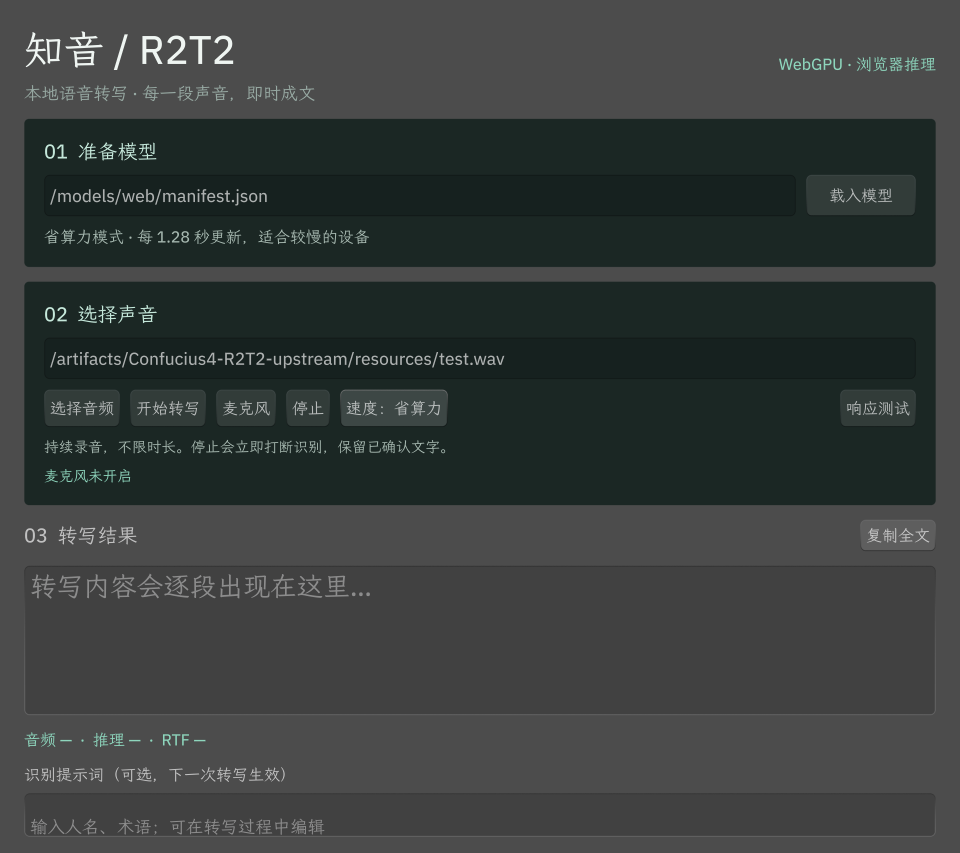
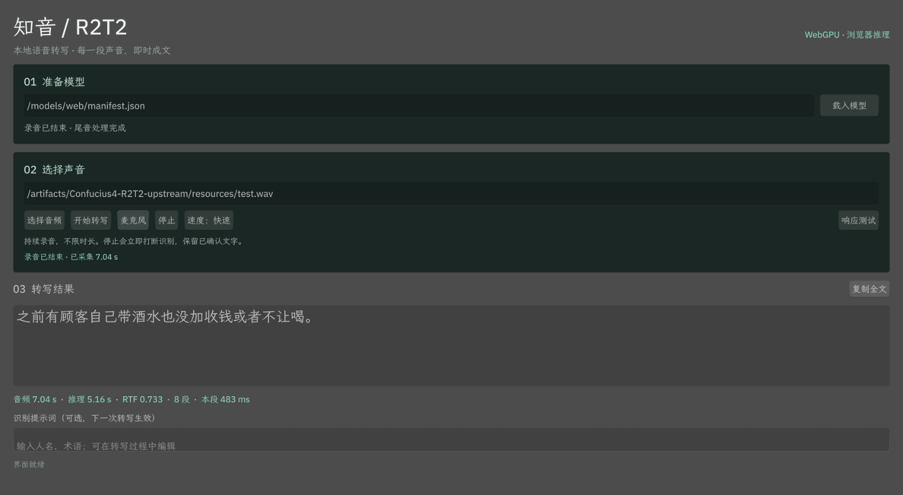
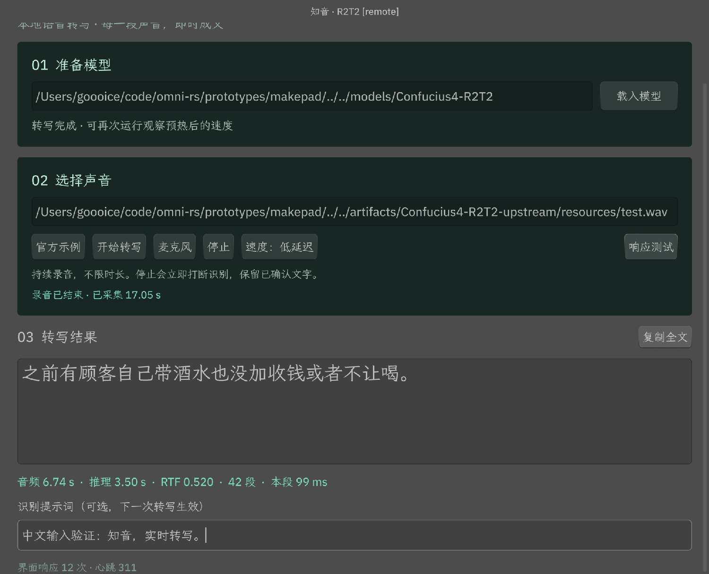
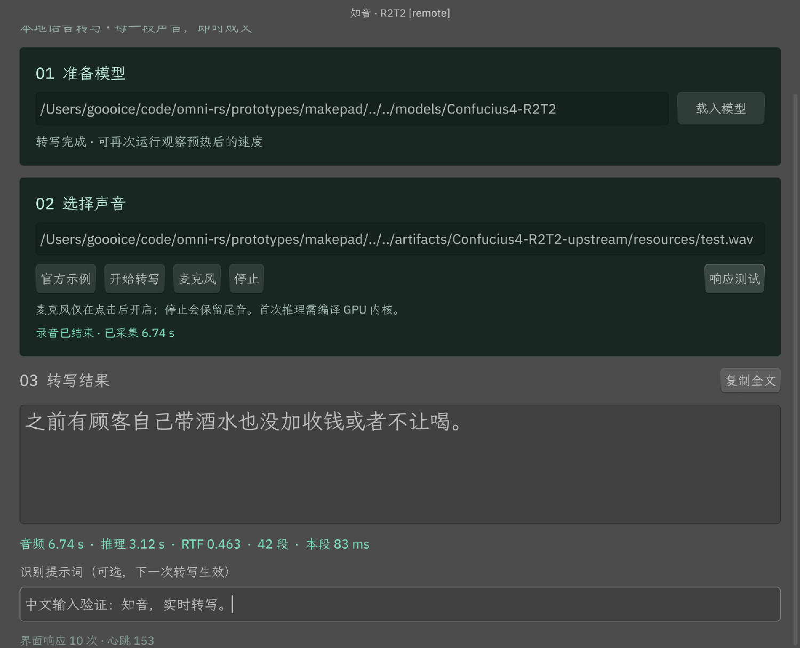
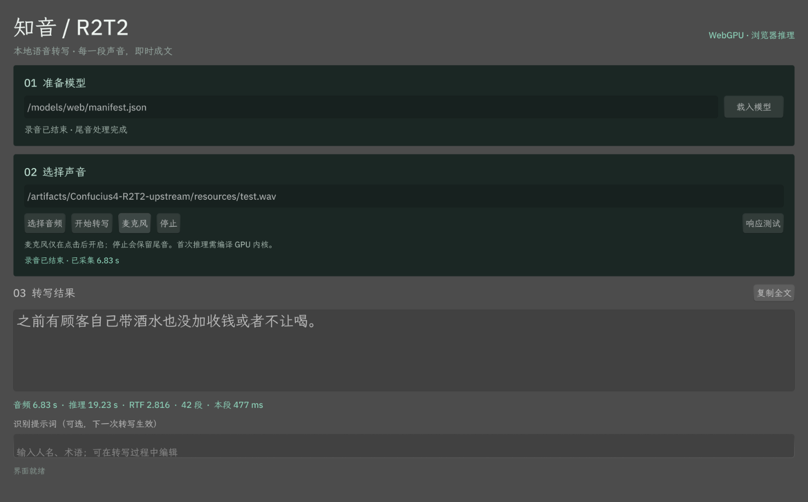
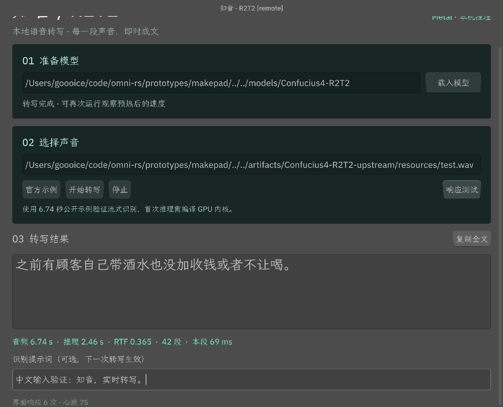
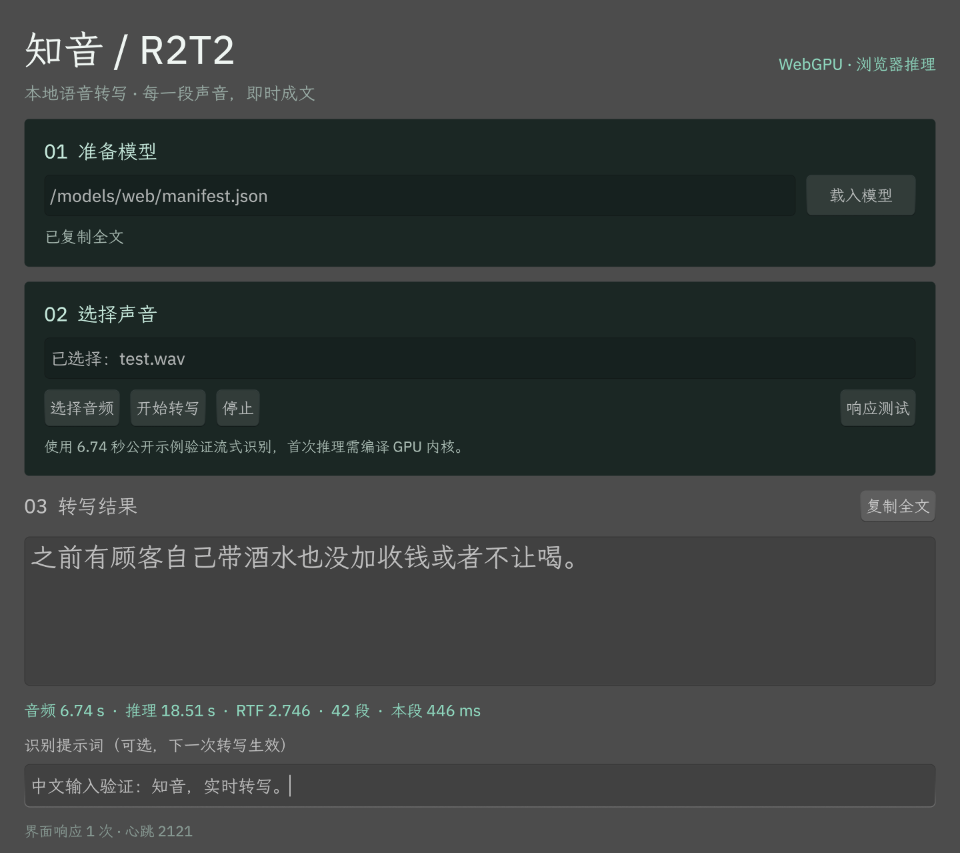

# Makepad 原型验证

## 2026-10-14 ASR/TTS 共享生命周期回归

桌面发布版已接入同一份 ASR 分块/EOF 推进和 TTS 采样/帧交付实现，首音频时间计到回调开始前。
24 项桌面单元测试、Web 检查及发布构建通过，1 项物理默认输出设备单元测试按原策略忽略。
完整权重隐藏窗口回归通过加载取消与重试、官方 WAV 转写、ASR/TTS 翻译、合成/播放分别停止，
以及再次合成期间保存旧结果。两份保存文件逐字节相同，为 24 kHz、5.84 秒。
文件面板回复由测试库提供；没有请求物理麦克风权限。

[桌面报告](../../artifacts/architecture-deepening/native/report.json)、
[最终截图](../../artifacts/architecture-deepening/native/final.png)、
[完整记录](../../VALIDATION.md)。两个启动路径已同步到本轮验证的发布程序。

## 2026-10-14 多模态缓存与批处理回归

发布版已包含共享分页内核、ASR 解码器重构和 TTS 64 行深度内核，继续采用桌面单任务调度。
ASR/TTS 连续批处理用于 HTTP 并发，桌面单请求的分页选项保持默认关闭。
24 项桌面单元测试、Web 检查及发布构建通过（1 项默认音频设备单元测试按原策略忽略）。

完整模型的隐藏窗口回归通过：加载停止后重试并识别官方 WAV、切页期间按顺序加载模型、
ASR/TTS 翻译、真实合成和播放、分别停止播放/推理、取消保存面板后重试、推理期间保存完成结果，
以及再次合成时保存上一份音频的不可变快照。保存 WAV 为 24 kHz、5.84 秒。
文件面板回复由测试库提供，未申请物理麦克风权限。

[桌面报告](../../artifacts/multimodal-batching/native/report.json)、
[截图](../../artifacts/multimodal-batching/native/final.png)、
[构建与哈希](../../artifacts/multimodal-batching/checks.json)。
两个原生启动路径同步到同一发布程序；各模型吞吐、分页默认策略和范围见[根验证记录](../../VALIDATION.md)。

## 2026-10-14 分页翻译路径

原生翻译改用 Hy-MT 的分页 KV 池与 Metal FP16 注意力内核，桌面单请求复用连续批处理执行器。
最终发布版通过完整模型实测：ASR 翻译保留原文、TTS 翻译期间保留新编辑、主动采用译文，
以及长文本停止后短句重试；停止只产生一个取消终态。
[报告](../../artifacts/paged-validation/native/report.json)、
[ASR 截图](../../artifacts/paged-validation/native/asr-translation.png)、
[TTS 截图](../../artifacts/paged-validation/native/tts-translation.png)。

24 项桌面回归通过，1 项音频设备测试默认忽略。发布构建及格式检查通过，两个原生启动路径已同步。
程序 SHA256、数值误差与 HTTP 连续批处理验证见[检查汇总](../../artifacts/paged-validation/checks.json)和
[根验证记录](../../VALIDATION.md)。ASR 的实验性 ANE 编译失败后回退，官方示例转写正确；翻译使用 Metal。

```sh
python3 prototypes/makepad/build-native.py
python3 prototypes/makepad/validate-translation.py --output artifacts/paged-native-validation-new
```

## 2026-10-14 共享执行、跨页停止与独立保存

`validate-lifecycle.py` 使用完整模型，在自己启动的隐藏原生窗口中验证：

- ASR 加载停止后重试，官方 WAV 转写与预期一致。
- 翻译加载时切到图像页并编辑，全局停止撤销待续跑翻译；空闲后只加载当前图像页，且可取消。
- 冷翻译完成后才开始加载仍选中的 TTS 页，原始转写保持不变。
- TTS 尾音和重播与翻译并行；停止播放不影响翻译，停止推理不影响重播。
- 推理期间取消保存对话框后可再次保存；下一次合成期间保存的仍是上一份结果，两份 WAV 逐字节相同。
- 810 像素高窗口滚动内容后，固定的全局停止与导航保持可见。

[报告](../../artifacts/lifecycle-validation/native/report.json)、
[滚动截图](../../artifacts/lifecycle-validation/native/scroll-with-global-stop.png)、
[播放与推理截图](../../artifacts/lifecycle-validation/native/playback-and-translation.png)。
输出音频为 24 kHz、5.84 秒。文件选择和保存使用测试库返回 `NSOpenPanel` / `NSSavePanel` 结果，
实际回调、编码与文件发布均走生产路径；没有操作系统文件面板的鼠标测试，也没有请求物理麦克风权限。
另在 ASR 编码器第 3 层、TTS 文本编码器第 10 层实际取消权重加载，两者均清理后成功重试。
[阶段取消报告](../../artifacts/lifecycle-validation/loading/report.json)。

24 项桌面测试通过，1 项依赖默认音频设备的单元测试默认忽略；上述原生回归实际运行了播放设备路径。
原生发布构建、Wasm 检查通过。该发布版 SHA256：
`325f4ceb03cb42f1c44c21feb65b71cc44f5bfd3e7da7057823ae88e4887eefc`。
API 生命周期、持久下载及数值检查见[根验证记录](../../VALIDATION.md#2026-10-14任务生命周期桌面并发与结果发布)。

```sh
python3 prototypes/makepad/build-native.py
python3 prototypes/makepad/validate-lifecycle.py --output artifacts/lifecycle-validation-new
```

## 2026-10-14 Hy-MT2 翻译

ASR 和 TTS 页面接入同一份 Hy-MT2-7B Metal FP16 模型与 Radix 前缀 KV 缓存。
首次点击翻译时按需加载，独立显示译文；TTS 的“用译文朗读”将结果填入输入框，随后可使用现有合成操作。
原生发布构建和 Wasm 检查通过，翻译控件只在原生入口显示；Web API 提供另一个浏览器入口。

`validate-translation.py` 在自己启动的隐藏 Makepad 窗口中，使用完整模型完成以下流程：

- 真实 WAV 转写后翻译为英文，ASR 原文保持不变，翻译期间禁止启动其他推理。
- TTS 翻译使用提交时的文本；推理期间的新编辑保留，主动点击后才应用译文。
- 长文本翻译停止只产生一个取消终态，随后短句翻译成功。

[报告](../../artifacts/hy-mt-native-validation/report.json)、
[ASR 截图](../../artifacts/hy-mt-native-validation/asr-translation.png)、
[TTS 截图](../../artifacts/hy-mt-native-validation/tts-translation.png)。
本次没有请求物理麦克风权限；实际语音合成和生成文件下载另经本地 HTTP / 浏览器验证，
数值对照和缓存测量见[根验证记录](../../VALIDATION.md)。

## 2026-10-11 启动自动加载

本地版启动即加载默认模型，原“准备模型”输入框与加载按钮不再显示。
进度条跟随实际加载阶段、24 层语音编码器与 28 层文本解码器推进，不使用计时器模拟进度，
也不表示耗时百分比；就绪后自动收起。加载期间禁止开始录音/转写，界面仍可响应操作。

默认或上次选中的目录不存在、文件不齐时弹出系统选择窗口。支持取消、重新选择、
选错目录后恢复、配置损坏后的重试；仅在成功加载后保存目录。
默认加载、选择文件自动使用其父目录、含中文/空格的路径、重启自动加载、
已保存目录被移动后重新选择均通过验证。

[启动报告](../../artifacts/native-startup/startup-final/summary.json)、
[加载截图](../../artifacts/native-startup/startup-final/default/loading.png)、
[就绪截图](../../artifacts/native-startup/startup-final/default/ready.png)。
测试在独立隐藏进程中使用完整 Metal 模型和隔离设置文件；目录选择使用测试库提供
`NSOpenPanel` 返回值，经由 Makepad 的真实原生回调，不覆盖系统选择窗口自身的鼠标/键盘操作。

9 项本地单元测试、Clippy、发布构建及 12 次转写/录音交互回归通过，包括 20.22 秒长流、
17 秒后主动停止、错误恢复与四档切换。
[交互报告](../../artifacts/native-startup/interaction-final/native.json)、
[构建记录](../../artifacts/native-startup/build-checks.json)。
此前的长停顿尾字用例也在最终构建通过：两次说话均在持续录音的停顿中补出尾字，
增量拼接与最终文本一致，[报告](../../artifacts/native-startup/pause-final/summary.json)。
录音回归使用按真实时间推进的 48 kHz 双声道测试音源，不请求物理麦克风权限。
ANE、模型计算和 Web 推理文件的 29 项校验值未变；Web 继续原加载交互，本轮未重新构建 Web。

该次构建 SHA-256：`82492266d2b41a57ad063d440bee649b240cccb5ba6aa7a0ea73cf55023d457a`。
`target/release/r2t2-makepad` 和 `target/makepad-native/release/r2t2-makepad` 均已更新。

## 2026-10-11 停顿尾字修复

本地麦克风启用稳定候选确认，复用现有解码结果，在至少 800 ms 新音频中保持不变的完整候选
可以提交此前回退的尾字，录音继续。文件、CLI、Web 默认策略以及 ANE/模型计算实现保持原样。

修复前，“恰恰在风格打法和比赛理念上”的“上”在 5 秒静音中一直未输出；修复后两次说话都在
停顿期间补出。降低 20 dB 音量、3 秒开头静音及继续说话跨越滚动窗口同样通过。
同一反例修复前后都是 56 个事件，无额外解码。测试音源经过真实时钟的采集缓冲和完整模型，
没有打开物理麦克风。

8 项核心测试、8 项模型/流式测试、Clippy、发布构建及 12 次原生交互回归通过。
`IMKCFRunLoopWakeUpReliable` 日志已定位为系统 HIToolbox 发送，尚未确认对应应用功能故障。
复现、边界和证据见[流程记录](../../docs/native-pipeline-optimization.md)。
该次停顿尾字修复构建 SHA-256：`374949854f6af860dd0644f31fd6dbf9f03be65e4b1941b9528608c37686999c`。

## 2026-10-11 本地流程优化

本轮仅优化本地 Metal 界面的采集、调度、显示与后处理；ANE 后端和模型计算实现保持原样。
7 项核心单元测试、8 项模型/流式测试和 8 项本地音频测试通过，含 992 组官方 Python 文本对照。
本地 Clippy 使用两项既有风格豁免，根项目 ANE/Core ML/麦克风组合 Clippy 使用原四项豁免，均通过。
发布构建通过。CPU 计数、准确率与停止验证以[本轮记录](../../docs/native-pipeline-optimization.md)为准。

最终构建完成 96 条中文测试，CER 为 39/1417（2.75%），控制版为 43/1417（3.03%）。
三轮短样本模拟录音的 CPU 总时间：均衡档减少 44.34%，低延迟档减少 22.55%；不是物理麦克风测试。
原生交互共 12 次运行通过，包括 20.22 秒跨窗口输入、17.03 秒时主动打断（单次约 103 ms）、
停止后重启、四档切换和错误恢复。报告为 `artifacts/native-pipeline/native-interaction/native.json`。
该构建的 SHA-256：`94b81043ff82c60b19e0f4e61262be8a25de3fef030d8ca037e400ca1f396c86`。

以下为按阶段保留的历史实验，旧 ANE + Metal 模型专用混合路径不是当前本地界面的默认后端。

## 历史 ANE 原生适配

新增的 Core ML 混合路径已在 M5 Max 验证：界面显示 `ANE + Metal · 本机推理`，Core ML
计算计划确认 2336 个音频 Transformer 算子分配给 ANE，文本解码保持 Metal。
模型常驻推理线程，Swift 桥接静态链接，主程序配置系统 Swift runtime rpath。

`python3 prototypes/makepad/validate-native.py --continuous --expect-ane --output artifacts/ane-validation/native-ui`
通过 11 次运行：文件转写、模拟麦克风、打断、重新录音、失败重试和 20.22 s 长流。
模拟麦克风为 48 kHz 双声道时钟音源；17.09 s 手动停止约 97 ms 返回，已发布文字保持一致。
没有打开物理麦克风。完整报告在 `artifacts/ane-validation/native-ui/native.json`；
编码精度误差、性能波动和限制见[根验证记录](../../VALIDATION.md#ane--metal-适配)。

Web 保持 WebGPU，发布构建通过；960×853 CSS 的 Retina 窗口仍使用 1920×1706 画布。
以下为此前 Metal/WebGPU 原型的历史验证记录。

2026-10-09，Apple M5 Max，macOS 27.0.1，128 GB 内存。原生 UI 与 Burn 都使用真实 Metal；Web UI 使用 Makepad WebGL，模型在独立 Worker 内使用 Burn WebGPU / FP16。使用完整原始模型，未替换成 mock 或小尺寸网络。

结论：Makepad 可以作为本项目的原生优先方案，两端能够复用 Rust 界面。M5 的预热吞吐满足实时预算；Web 新增快速档，在本机受控音源测试中也能跟上输入。以下数值是单个公开样本的原型验证，不是完整语料集或跨设备性能结论。

## Web 清晰度修正

原型此前使用 Makepad 默认的 1.5 倍 DPR / 2 MiPixels 限制。实测 Retina DPR 为 2，960 × 853 CSS 像素的窗口仅生成 1440 × 1279 画布，浏览器放大后文字变软。Canvas 设置 `maxdpr="8"`、`renderpixelbudget="16777216"` 后，同一窗口绘制为 1920 × 1706，与屏幕像素密度匹配。

浏览器验证了 DPR 2 下的 1200 × 900 和 2560 × 1440 窗口：实际 WebGL drawing buffer 分别为 2400 × 1800、5120 × 2880；无 context loss、render target rejection 或应用错误。速度按钮在相同 CSS 坐标仍可点击。测试工具会重置其他 DPR 的模拟值，因此不将该部分计为已验证。报告为 `artifacts/web-clarity-validation.json`。



## 持续采集与 Web 提速（历史记录）

取消由推理积压触发的自动停录。原生用私有临时目录保存分段 PCM，Web 用 IndexedDB；读取后释放已消费记录，正常结束和停止均删除会话缓存。Web 采集信用在存储提交后返还，Worker 仅拉取一个包，推理积压与内存传输缓冲分离。

停止立即关闭采集、取消未处理音频和未确认尾音，保留已经发布的文字。独立的 `WebStopHandle` 可以在 `WebSession.push()` / `finish()` 异步借用期间请求打断；等当前 GPU readback 返回后释放 session，不启动最终解码。原生使用同一个原子取消标志。自然结束仍会刷新尾音，刷新期间的停止按钮保持可用。

Web 默认快速档（960 ms / 无前瞻 / 每块 8 tokens）；原生默认低延迟档（160 / 160 ms / 4 tokens）。两端还可选省算力档（1280 ms / 无前瞻 / 12 tokens）。完整权重仍为 FP16；提速来自降低重复编码与前缀解码频率。每块音频更长，文字更新间隔也更长。

同一个 WebGPU Worker 中顺序运行的配置对照，墙钟时间不含模型载入、WAV 解码和音频播放等待：

| 配置 | 6.74 s 样本耗时 / RTF | 20.22 s 重复样本耗时 / RTF |
|---|---|---|
| 旧配置 160 / 160 ms、4 tokens | 18.676 s / 2.771 | 未重测 |
| 对照 640 / 160 ms、8 tokens | 6.022 s / 0.893 | 18.721 s / 0.926 |
| 快速 960 / 0 ms、8 tokens | 4.737 s / 0.703 | 13.971 s / 0.691 |
| 省算力 1280 / 0 ms、12 tokens | 3.982 s / 0.591 | 11.469 s / 0.567 |

短样本各档全文相同；长样本均完整转写三遍正文，标点为重复句之间的逗号，增量拼接一致。这是同一公开样本及其重复版本的验证，不能推断不同口音、噪声和语速的总体准确率。对照报告：`artifacts/web-speed-bench/initial.json`、`long.json`。

当前链路验证：

- 原生 48 kHz 双声道受控音源：20.22 秒输入跨过滚动窗口，全文一致；另一次录音在 17.05 秒手动停止，已确认音频为 16.80 秒，停止往返约 93 ms。停止后可直接创建新会话，设备打开失败后的重试、文件转写与中文编辑回归通过。
- 浏览器真实 IndexedDB：推理消费者完全停顿时仍接收 60 秒 PCM；随后每个样本按序取出，已消费记录数归零；停止与未提交写入并发时仍完整清理数据库。
- Web 快速档完整采集 20.48 秒（含兼容采集静音尾部），累计推理 15.283 秒，RTF 0.746，三遍全文正确，增量一致。采用 16 kHz AudioContext 与 80 ms 数据包。
- Web 人工降低到 160 ms 配置制造积压：采集 17.04 秒、待处理 11.52 秒时仍处于录音状态；点击停止后约 68 ms 返回，未处理音频取消，已确认全文与增量一致，IndexedDB 临时数据库数量归零。回调延迟警告没有终止录音。
- 最终构建的快速档短样本界面回归：6.74 秒音频推理 5.151 秒，RTF 0.764，包含界面操作/取数的墙钟 5.237 秒，8 个事件，全文正确。
- 最终界面还验证了采集初始化期间立即停止，以及停止后使用同一模型重新录音：完整短句正确，7.04 秒输入含兼容适配静音尾部，RTF 0.733，无采集延迟警告、无应用错误。
- 自然音源结束后，仍有约 4.16 秒积压时，停止按钮仍可用；取消约 874 ms 返回，增量一致，临时数据库归零。停止耗时取决于正在执行的 GPU 运算，68 ms 是一次实测值，并非延迟上限。
- 核心库 6 项单元测试和 7 项模型一致性测试通过；原生音频缓冲 3 项、磁盘缓存 2 项通过；Web 音频协议 14 项通过，浏览器实际 IndexedDB 3 项通过。

Ego / Chromium 152 的 AudioWorklet `addModule()` 仍未返回，本次完整采集测试使用 ScriptProcessorNode 兼容路径。重负载测试发现兼容采集的回调时间可能跳变，已改为提示“采集曾延迟，可能漏字”并继续采集，手动停止仍随时生效。已经遗漏的硬件样本无法恢复；没有宣称兼容路径可保证后台/长期无丢帧。真实麦克风权限、硬件音质、设备热插拔和其他浏览器仍需实机验收。

原生与 Web UI 报告、协议结果和截图见 `artifacts/continuous-validation/`；`web-compatibility-gap.json` 保留修复前的回调中断反例。原生 UI 测试的一部分与浏览器压测并发，仅用于正确性验收，不与此前独占 GPU 的速度基线作性能比较。





## 旧版麦克风基线（以下停止策略已被替换）

以下是首次接入麦克风时的历史记录。该版本的“8 秒积压自动停录”和“停止后排空”已被本文上方的持续采集/即时打断替换，速度数据使用旧 160 ms 配置。所有麦克风自动化均使用可控公开音源，没有打开真实麦克风。

- 原生：官方样本转换为 48 kHz 双声道，按 10 ms 的真实时钟节拍写入同一个采集缓冲。完整 6.74 秒全部送达模型，42 个流式事件，最终文本正确。预热后两次 RTF 为 0.383 / 0.380，录音到尾音处理完成约 6.94 秒，测试按钮响应约 1 ms。停止时保留全部已采集音频；输入打开失败后可直接重试；既有 WAV 流程回归通过。
- Web：真实 `AudioContext` 在 48 kHz 运行，以无声 `AudioBufferSourceNode` 模拟输入设备。经采集、双通道混合、Rust sinc 重采样和完整 WebGPU 模型后得到正确全文，增量拼接一致。完整一次接收 6.827 秒（含兼容适配的短静音尾部），最终版本推理约 19.23 秒，RTF 2.816。2.773 秒处停止的测试也保留全部已接收数据，最终文本“之前有顾客自己带酒”，随后可再次录音。
- 长录音积压：输入 20.22 秒的重复样本，在已采集 12.8 秒、待处理接近 8 秒时自动停止，继续完成这 12.8 秒的 80 个事件，增量拼接等于最终文本，明确提示分段录音。
- 权限与生命周期：单元测试和实际界面的受控 `getUserMedia` 替身验证了拒绝权限、等待权限时停止，以及授权迟到后立即释放返回的轨道；没有处理、批准或绕过浏览器录音权限弹窗。
- 边界协议：Rust 缓冲的 3 个测试、Web 音频协议的 11 项检查和核心库的 6 个测试通过。包括并发顺序、变长渲染帧、双声道混合、最后 37 个样本、八秒积压上限、时间缺口、挂起、尾包早于 finish/free，以及旧会话数据隔离。

当前测试浏览器为 Ego / Chromium 152。AudioWorklet `addModule()` 在应用和独立的最小测试页均未返回，原因未确定；Web 完整音频链路实测使用自动降级的兼容采集路径。AudioWorklet 的共享分包器、消息和 credit 协议经过隔离测试，但其浏览器真实渲染线程仍未完成端到端验收。兼容路径使用已弃用的 ScriptProcessorNode，在主线程繁忙时可靠性较低，不据此宣称 Web 已满足持续实时录音。

未实测：真实输入设备的系统授权、麦克风硬件音质、设备拔插、长时间后台运行和其他操作系统。原生录音线程的无输入超时与设备错误处理已实现，真实设备验收仍需在界面中点击“麦克风”。

可复核命令与测试音源入口见 [README](README.md)。报告位于 `artifacts/makepad-microphone-validation/`：`native.json` / `native.log`、`web-first.json`、`web-stopped.json`、`web-permission-simulation.json`、`web-recovered.json`、`web-overflow.json`、`web-final.json`。修复了兼容适配在主动结束后的静音排空阶段误报时间缺口的问题；最终版本再次验证完整样本。权限报告中的拒绝错误由测试主动注入。





## 完整模型（此前的文件原型基线）

样本：上游 `resources/test.wav`，16 kHz 单声道，6.74 秒，SHA-256：
`b703174ef013bf7332ab74d4b65d568e2981cff2633cb620252bb4ba18ea7f67`。

两端最终文字均为：

> 之前有顾客自己带酒水也没加收钱或者不让喝。

每次完整识别包含 42 个事件，所有 `delta` 拼接等于最终文字。16 kHz PCM 按 320 个采样点分包，模型按原有 160 ms 流式配置解码。文件尽快送入引擎，没有真实麦克风输入或音频时钟节拍。

| 场景 | 推理累计耗时 | RTF |
|---|---:|---:|
| 原生，进程内首次识别 | 9.268 s | 1.375 |
| 原生，预热后 | 2.462 s | 0.365 |
| 原生，取消后重新识别 | 2.479 s | 0.368 |
| 原生，文件错误后重新识别 | 2.460 s | 0.365 |
| Web，完整识别 | 18.553 s | 2.753 |
| Web，同一模型再次识别 | 18.475 s | 2.741 |
| Web，文件错误后重新选择同一文件 | 18.506 s | 2.746 |

RTF = 累计推理时间 / 音频时长，小于 1 表示吞吐快于音频播放速度。此处耗时不含模型加载、WAV 解码、UI 绘制或整次操作墙钟时间。原生本轮加载约 4.2 s，Web 加载受浏览器缓存影响较大；上表两次 Web 识别所在进程加载约 22.1 s。

两个平台分别测量，未同时运行识别。首次运行涉及内核编译/调优，不能用预热数字承诺开箱即用的首字延迟。与根目录既有 Burn 结果属于同一性能量级，尚未进行严格的 UI 开销 A/B 测试。

## 交互验证

原生自动化检查均通过：完整模型加载、连续识别、流式增量一致性、处理中点击响应按钮、停止并刷新、停止后创建新会话、缺失文件报错后重试，以及中文 Unicode 输入和全选替换。每次只控制测试脚本启动的隐藏窗口，截图来自该窗口的 Metal drawable，完成后进程退出。

Web 已验证完整识别、同源音频 URL、本地文件选择、流式增量、转写期间的响应按钮和中文编辑、中文粘贴、浏览器 IME 组合提交、选择文本，以及复制按钮写入剪贴板后粘贴回输入框。取消发生在约 4 秒音频处，保留文本“之前有顾客自己带酒水也没”，`cancelled=true`，增量仍与最终文本一致。

Web 的错误恢复额外测试了不存在的 URL（预期 HTTP 404），随后重新选择同一个本地文件并成功识别。最终 JS 版本再次通过复制/粘贴往返。日志中保留的这条 404 是主动触发的测试错误。

Web 中文组合输入使用 Chromium CDP `Input.imeSetComposition` / `Input.insertText`，测试得到“中文测试实时”。原生使用 Makepad 注入 Unicode。两者都不等于人工操作 macOS 中文输入法候选窗；候选位置、拼音候选翻页、长时间输入法切换仍需人工验收。

## 选型中发现的成本

1. 固定 Makepad 版本在单线程 Web 构建下报告线程池不可用，中文持续显示方框。用最终相同应用源码、显式字体和布局刷新重新做单线程对照，问题仍复现。采用官方线程编译参数、nightly `build-std` 和 COOP/COEP 后恢复正常。
2. 异步字体加载后，预填输入框需刷新布局；应用层已处理。中文字体与模型是独立资源，Web 发布需考虑字体体积。
3. 该版本的 Web `CopyToClipboard` 分支只输出“不支持”日志。原型使用应用自己的 JS 消息桥完成真实剪贴板写入，并验证了复制/粘贴往返。
4. 相同文件的重复选择需要清空隐藏 file input 的 value；选中的 File 由适配层保留，避免错误后重新选择同一文件不触发 change。
5. Web 页面只暴露 canvas，缺少与按钮、输入框一一对应的 DOM 语义。读屏、Tab 焦点顺序、移动端键盘和多种浏览器需后续专门评估。

没有修改 Makepad 或 Burn 源码来通过验证。Windows、Linux、Safari、手机、ANE、真实麦克风长期输入、音频设备热插拔、安装包均不在已验证范围内。

## 可复核材料

- 原生测试脚本：[validate-native.py](validate-native.py)
- 原生完整事件、检查与度量：`artifacts/makepad-validation/native.log`、`native.json`
- Web 两次完整事件：`artifacts/makepad-web-final-run-1.json`、`makepad-web-final-run-2.json`
- Web 取消事件：`artifacts/makepad-web-cancel.json`
- Web 最终版本错误恢复与剪贴板：`artifacts/makepad-web-recovered.json`
- 单线程反例截图：`artifacts/makepad-single-threaded-settled.png`
- 原生截图：`artifacts/makepad-validation/native.png`（为检查底部中文输入而滚动过窗口）
- Web 截图：`artifacts/makepad-validation/web.png`





源码运行说明见 [README](README.md)。以下为**新增麦克风之前**的文件原型基线 SHA-256（当前构建已更新）：

原生二进制：
`413ab3b5e60c9b5f55cf8b3dd00df3d91092d9e48697df4d05901cd4a40e7eae`。
Makepad UI Wasm SHA-256：
`b6589f09c183766db3e23a64f5665c5f32019ee1f8ead3bfc975e55fa9e8d56f`。


上一版麦克风基线 SHA-256（已更新构建）：

- 原生二进制：`8bac15c82e0aebf0d397806f54e4cefb8dc17254a59fa6396499d5c37ce5cd36`
- Makepad UI Wasm：`e18110abd49c3f122eb99a9c9d3cd3524985781b81b30eb4a6f328af3d3c3fff`
- Burn Wasm（含 WebResampler）：`185747847959261838fc4bb4ba40a6838bfd036b52940952f7b17229532e9ab4`

当前持续录音版本构建 SHA-256：

- 原生二进制：`3ec6ef64974999e5b614d68ee8d7c01bc5b3fec069d01ef7f23e088af391e665`
- Makepad UI Wasm：`71fd7814f0b8b416b63498f55c61251bc9b85f1d4a881b09685fb7e063393b3b`
- Burn Wasm（含打断句柄）：`6ac89065e66b5ced9bee2e580a10a2e6bfc8772e41b3435c549a1321f3bb9036`
